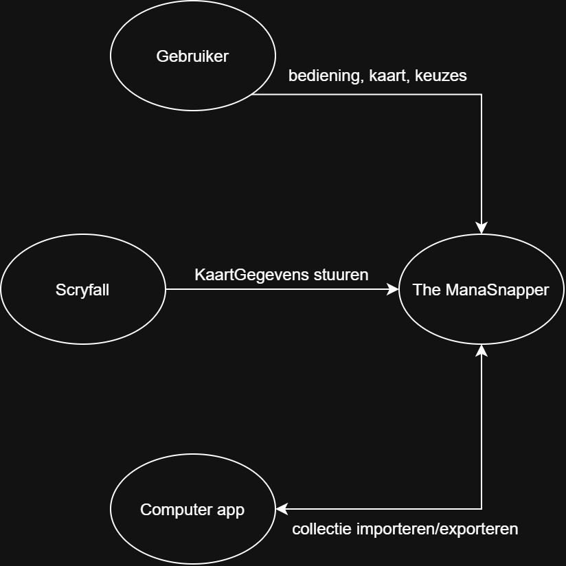
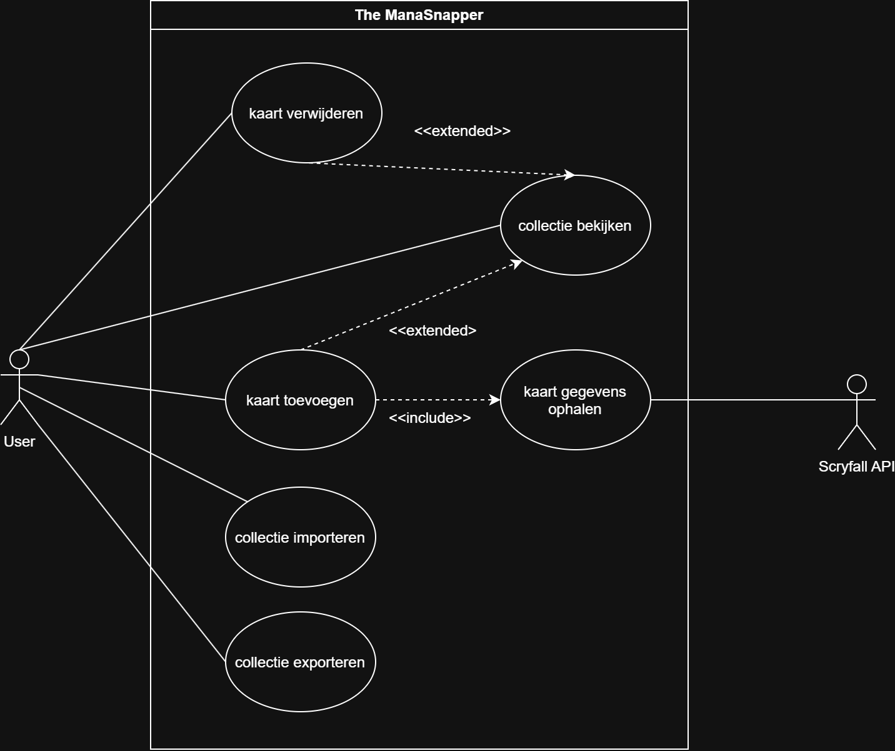
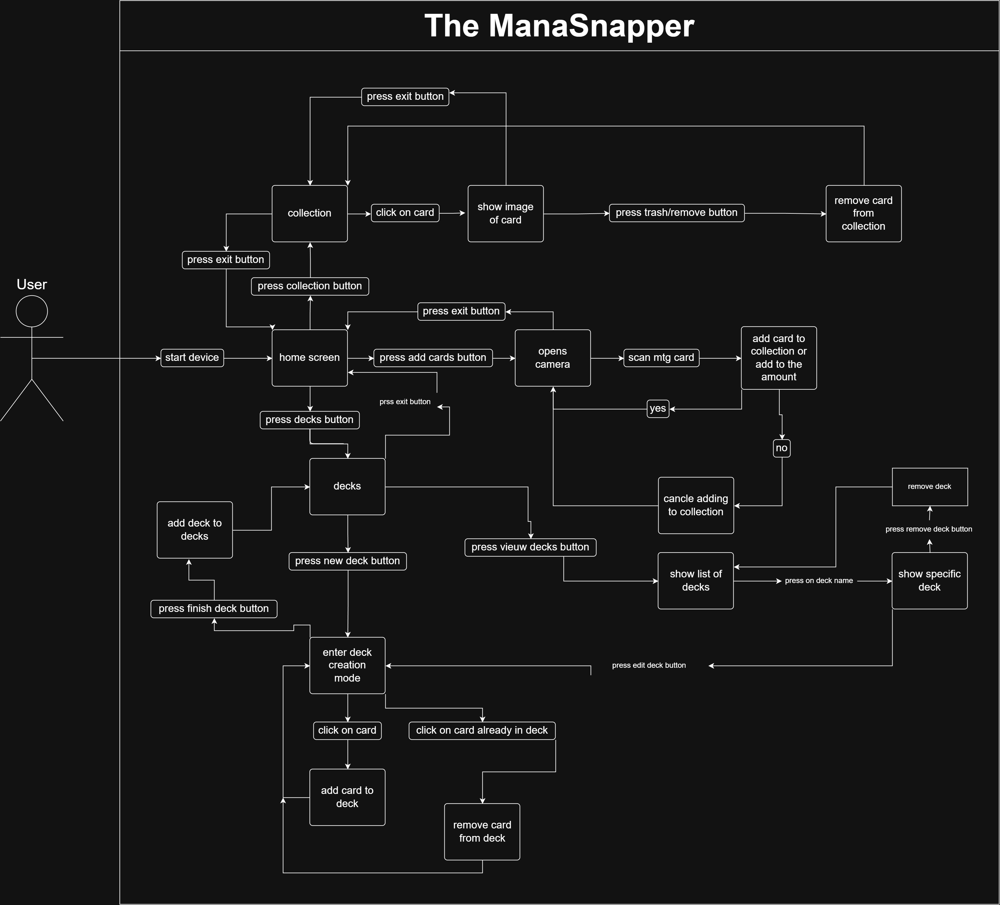
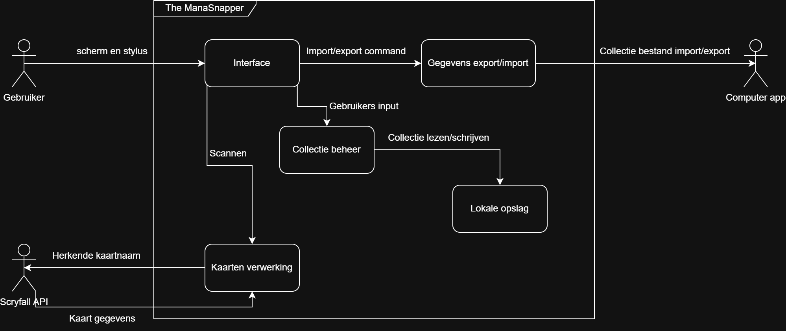
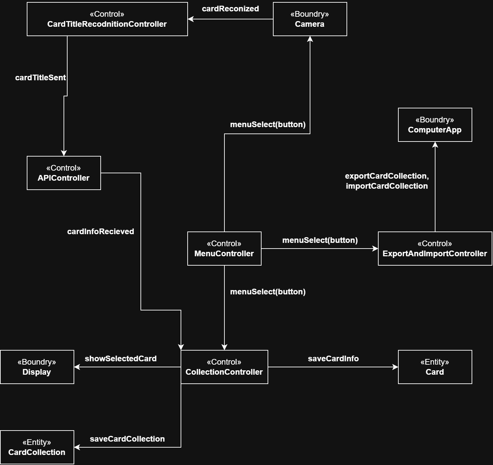
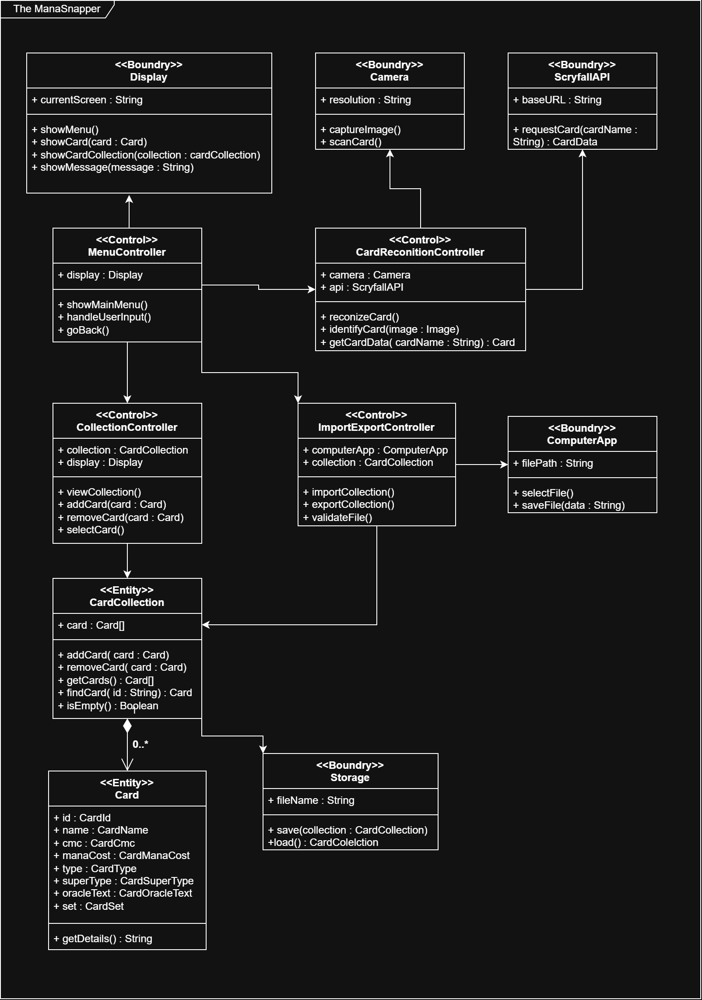
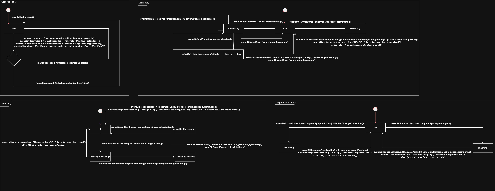

# Ontwikkeldocument Project The ManaSnapper

Versie 0.0.1

Team: The ManaEngineer

## Inhoudsopgave

- [Ontwikkeldocument Project The ManaSnapper](#ontwikkeldocument-project-the-manasnapper)
  - [Inhoudsopgave](#inhoudsopgave)
  - [Inleiding](#inleiding)
  - [Leeswijzer](#leeswijzer)
  - [Uitgangspunten](#uitgangspunten)
    - [Systeem Context](#systeem-context)
    - [Identificatie en prioritering van Key Drivers](#identificatie-en-prioritering-van-key-drivers)
  - [Requirements](#requirements)
    - [Functionele Requirements](#functionele-requirements)
    - [Niet-Functionele Requirements](#niet-functionele-requirements)
    - [Constraints](#constraints)
    - [Use Cases](#use-cases)
    - [Activity Diagrammen](#activity-diagrammen)
  - [Ontwerp](#ontwerp)
    - [Functionele decompositie / (sub)systems and interfaces](#functionele-decompositie--subsystems-and-interfaces)
    - [Objectmodellen](#objectmodellen)
      - [Lijst met Objecten](#lijst-met-objecten)
    - [Taakstructurering](#taakstructurering)
      - [Taaksoort en deadline](#taaksoort-en-deadline)
      - [Taken samenvoegen](#taken-samenvoegen)
    - [Klassediagrammen](#klassediagrammen)
    - [STD's](#stds)
  - [Realisatie](#realisatie)
    - [Code](#code)
    - [Eindresultaat](#eindresultaat)
  - [Conclusie en Advies](#conclusie-en-advies)
  - [Appendices](#appendices)
    - [Appendix 1: Referenties](#appendix-1-referenties)

## Inleiding

Het doel van het project is het maken van **The ManaSnapper**. een draagbaar apparaat waarmee gebruikers fysieke kaarten kunnen scannen en beheren in een digitale collectie. Het apparaat beschikt hiervoor over een camera en een scherm met een stylus. Na het herkennen van een kaart worden de bijbehorende kaartgegevens opgehaald, waarna de gebruiker de kaart aan de collectie kan toevoegen, de collectie kan bekijken of kaarten kan verwijderen.

Naast het fysieke apparaat wordt een computer app voorzien. De collectie kan tussen het apparaat en de applicatie worden geïmporteerd en geëxporteerd, zodat de gebruiker de kaartgegevens ook op een computer kan beheren. In de verdere uitwerking zijn onder andere het maken en beheren van decks, het testen van decks, een kaart van de dag en mogelijke uitbreidingen. De MVP richt zich op het fyzieke apperaat en de data kunnen overzetten op de computer (zonder app).

## Leeswijzer

Dit ontwikkeldocument beschrijft de ontwikkeling van The ManaSnapper van aanleiding en uitgangspunten tot ontwerp, realisatie en evaluatie. De hoofdstukken volgen de ontwikkeling van het product en bouwen op elkaar voort.

In **Uitgangspunten** worden de systeemcontext, de betrokken stakeholders en de belangrijkste key drivers van The ManaSnapper beschreven. Deze bepalen samen met de opdrachtbeschrijving welke eisen belangrijk zijn.

In **Requirements** zijn die eisen uitgewerkt als functionele en niet-functionele requirements, constraints en use cases. Samen vormen zij de meetlat voor het ontwerp en de oplevering.

In **Ontwerp** wordt uitgewerkt hoe The ManaSnapper aan die eisen voldoet. De functionele decompositie verdeelt het systeem in subsystemen en interfaces, waarna objectmodellen, taakstructurering, klassediagrammen en state transition diagrams (STD's) de samenwerking en toestanden verder uitwerken. Samen vormen deze onderdelen de basis voor de realisatie.

**Realisatie** vertaalt het ontwerp naar de daadwerkelijke firmware en PC-service. Het onderdeel **Code** koppelt iedere STD aan de bijbehorende bestanden in de repository. **Eindresultaat** vat samen welke requirements zijn behaald, welke prestaties zijn gerealiseerd en wat nog niet in de MVP zit.

**Conclusie en Advies** sluit af met een reflectie op de behaalde requirements en aanbevelingen voor doorontwikkeling. In de **Appendices** staat de lijst met gebruikte externe bronnen en licenties.

## Uitgangspunten

Dit hoofdstuk beschrijft de uitgangspunten voor de requirements van The ManaSnapper. Hierbij worden de systeemcontext, de systeemgrenzen, de betrokken stakeholders en de belangrijkste key drivers behandeld. Deze uitgangspunten zijn gebaseerd op de projectinformatie en de input van de opdrachtgevers.

### Systeem Context

The ManaSnapper is het systeem binnen de systeemgrens. Het systeem bestaat uit het fysieke apparaat en de bijbehorende functionaliteit voor het beheren van kaartgegevens. De gebruiker bedient The ManaSnapper, voert keuzes in en biedt fysieke kaarten aan om te scannen. 

The ManaSnapper gebruikt Scryfall als externe bron voor kaartgegevens via de gratis api. Nadat een kaart is herkend, worden de bijbehorende gegevens uit Scryfall opgehaald en gebruikt binnen de collectie.

Daarnaast wisselt The ManaSnapper collectiegegevens uit met de computer app. Hierdoor kan de gebruiker een collectie vanaf het apparaat naar de app exporteren en bestaande collectiegegevens vanuit de app importeren.

### Identificatie en prioritering van Key Drivers

| Prioriteit | Key driver | Stakeholder | Omschrijving |
|---|---|---|---|
| 1 | Controle over de collectie | Gebruiker, opdrachtgever | De gebruiker moet zelf kunnen bepalen welke kaarten in de collectie staan. Kaarten kunnen daarom bewust worden toegevoegd, bekeken en verwijderd. |
| 2 | Betrouwbare kaartgegevens | Gebruiker, opdrachtgever | Een fysieke kaart moet correct worden herkend en de bijbehorende gegevens moeten betrouwbaar uit Scryfall worden opgehaald. Bij een mislukte herkenning of ontbrekende gegevens moet het systeem dit duidelijk melden. |
| 3 | Inzicht in de collectie | Gebruiker, klant | De gebruiker moet op ieder moment kunnen zien welke kaarten in de collectie staan en de gegevens van deze kaarten kunnen controleren. |
| 4 | Behoud en bereikbaarheid van de collectie | Gebruiker, opdrachtgever | Wijzigingen in de collectie moeten correct worden opgeslagen en de collectie moet tussen The ManaSnapper en de computerapplicatie kunnen worden uitgewisseld. Hierdoor houdt de gebruiker ook op verschillende apparaten controle over dezelfde collectie. |

## Requirements

Dit hoofdstuk beschrijft wat The ManaSnapper moet kunnen en aan welke voorwaarden het moet voldoen. De functionele requirements beschrijven het gedrag, de niet-functionele requirements de kwaliteit, de constraints de ontwerpgrenzen en de use cases de interactie met de gebruiker. Samen vormen deze onderdelen de basis voor het ontwerp van The ManaSnapper.

### Functionele Requirements

| Naam | Omschrijving | Rationale | Business prioriteit |
|---|---|---|---|
| **F01 - Navigeren door het systeem** | Het systeem toont een hoofdmenu waaruit de beschikbare functies kunnen worden gestart. Vanuit iedere functie kan het systeem via een terugknop of annuleeractie terugkeren naar het hoofdmenu of het bijbehorende bovenliggende menu. | Een duidelijke navigatiestructuur maakt het mogelijk om de collectie doelgericht te bekijken en te beheren. | **Must** |
| **F02 - Kaart identificeren** | Het systeem gebruikt de camera om een aangeboden fysieke kaart te scannen en de kaartnaam te identificeren. | Een correcte identificatie is nodig om te bepalen welke kaart aan de collectie wordt toegevoegd en ondersteunt de key driver **Betrouwbare kaartgegevens**. | **Must** |
| **F03 - Kaartgegevens ophalen** | Het systeem zoekt de geïdentificeerde kaart op via de Scryfall API en ontvangt de bijbehorende kaartgegevens. | Betrouwbare kaartgegevens zijn nodig om een kaart correct te tonen en aan de collectie toe te voegen. Dit ondersteunt de key driver **Betrouwbare kaartgegevens**. | **Must** |
| **F04 - Kaartgegevens tonen** | Het systeem toont de opgehaalde kaartgegevens en biedt de mogelijkheid om het toevoegen aan de collectie te bevestigen of te annuleren. | De gebruiker moet kunnen controleren of de herkende kaart juist is voordat de collectie wordt gewijzigd. | **Must** |
| **F05 - Kaart aan collectie toevoegen** | Het systeem voegt een bevestigde kaart toe aan de collectie en slaat de bijgewerkte collectie op. | De gebruiker bepaalt hiermee welke kaarten onderdeel zijn van de collectie. Dit ondersteunt de key driver **Controle over de collectie**. | **Must** |
| **F06 - Collectie bekijken** | Het systeem toont de opgeslagen kaarten in de collectie en kan de details van een geselecteerde kaart tonen. | De gebruiker moet de opgeslagen collectie kunnen controleren en beheren. | **Must** |
| **F07 - Kaart uit collectie verwijderen** | Het systeem verwijdert een geselecteerde kaart pas na bevestiging en slaat de bijgewerkte collectie op. | De gebruiker moet de collectie kunnen beheren en ongewenste kaarten kunnen verwijderen. | **Must** |
| **F08 - Collectie importeren** | Het systeem haalt een geldig collectiebestand van de PC-service op, controleert het bestand en vervangt daarmee de volledige lokale collectie. | Importeren zorgt ervoor dat de gebruiker een bestaande collectie kan blijven beheren en ondersteunt de key driver **Behoud en bereikbaarheid van de collectie**. | **Should** |
| **F09 - Collectie exporteren** | Het systeem zet de collectie om naar JSON en slaat deze op de PC-service op als `collection_export.json` naast `server.py`; de gebruiker kiest geen locatie of bestandsnaam. | Exporteren maakt het mogelijk om een back-up te bewaren en de collectie op een computer te gebruiken. | **Should** |
| **F10 - Fouten en resultaten melden** | Het systeem toont een duidelijke melding wanneer een handeling succesvol is afgerond, wordt geannuleerd of niet kan worden uitgevoerd. De bestaande collectie blijft ongewijzigd wanneer een bewerking mislukt. | Duidelijke feedback voorkomt onbedoelde wijzigingen en ondersteunt de key driver **Controle over de collectie**. | **Must** |

### Niet-Functionele Requirements

| Naam | Omschrijving | Rationale | Business prioriteit |
|---|---|---|---|
| **NF01 - Betrouwbaarheid** | Bij een mislukte kaartidentificatie, ontbrekende kaartgegevens of een niet-bereikbaar extern systeem toont The ManaSnapper een foutmelding en blijft de bestaande collectie ongewijzigd. | De gebruiker moet erop kunnen vertrouwen dat een fout niet leidt tot verkeerde of verloren kaartgegevens. | **Must** |
| **NF02 - Gegevensbehoud** | Na het succesvol toevoegen of verwijderen van een kaart worden de wijzigingen opgeslagen voordat het systeem de handeling als voltooid meldt. | Hierdoor blijven wijzigingen behouden en raakt de collectie niet ongemerkt verouderd. | **Must** |
| **NF03 - Gebruiksvriendelijkheid** | Iedere functie toont duidelijk welke actie beschikbaar is en bevat een zichtbare terug- of annuleeractie waarmee de gebruiker naar het hoofdmenu of het bovenliggende menu kan terugkeren. | Dit ondersteunt eenvoudige bediening en voorkomt dat de gebruiker vast komt te zitten in een scherm. | **Must** |
| **NF04 - Prestaties** | Het systeem toont binnen 3 seconden een reactie nadat de gebruiker een menuoptie of knop heeft geselecteerd. Wachttijd op externe aanvragen (Scryfall, OCR en import/export) valt buiten deze verwerkingstijd en wordt begrensd door de daarvoor ingestelde time-outs. | Een snelle reactie maakt de bediening begrijpelijk en voorkomt dat de gebruiker opnieuw op een knop drukt. | **Should** |
| **NF05 - Foutmeldingen** | Foutmeldingen beschrijven in begrijpelijke taal wat er is misgegaan en geven aan wat de gebruiker vervolgens kan doen. | De gebruiker moet problemen kunnen herkennen en zelfstandig kunnen herstellen of terugkeren naar het hoofdmenu. | **Must** |
| **NF06 - Draagbaarheid** | Het fysieke apparaat kan zonder permanente aansluiting op een computer worden gebruikt en beschikt over een oplaadbare voeding. | Hierdoor kan de gebruiker de collectie ook buiten de computer beheren en blijft de collectie bereikbaar. | **Must** |
| **NF07 - Gegevensuitwisseling** | Geëxporteerde collectiegegevens kunnen door de computerapplicatie worden ingelezen en geïmporteerde geldige collectiegegevens kunnen door The ManaSnapper worden gebruikt. | De collectie moet tussen het apparaat en de computer kunnen worden uitgewisseld zonder handmatige omzetting van kaartgegevens. | **Should** |
| **NF08 - Uitbreidbaarheid** | De softwarestructuur scheidt kaartidentificatie, externe kaartgegevens, collectiebeheer en gebruikersinterface, zodat toekomstige functies kunnen worden toegevoegd zonder de bestaande kernfunctionaliteiten opnieuw te ontwerpen. | Een duidelijke scheiding houdt het beheer van de collectie betrouwbaar wanneer later extra functies worden toegevoegd. | **Could** |

### Constraints

| Naam | Omschrijving | Rationale |
|---|---|---|
| **C01 - Bediening via het apparaat** | De gebruiker bedient het fysieke apparaat via het scherm en een stylus. De MVP vereist geen toetsenbord, muis of permanente bediening vanaf een computer. | The ManaSnapper moet als draagbaar zelfstandig apparaat kunnen functioneren. De gekozen interface en navigatie moeten daarom op het scherm uitvoerbaar zijn. |
| **C02 - Oplaadbare voeding** | Het apparaat gebruikt een oplaadbare 18650-batterij met de aanwezige TP4056-laadmodule en moet zonder permanente aansluiting op een computer kunnen werken. | Draagbaarheid is een uitgangspunt van het product. De voeding mag daarom niet afhankelijk zijn van een vaste USB- of computerverbinding tijdens normaal gebruik. |
| **C03 - Lokale opslag** | De collectie wordt lokaal op het apparaat opgeslagen via de microSD-module. De oplossing moet rekening houden met de eindige opslagcapaciteit en met het behoud van geldige collectiegegevens bij het uitschakelen van het apparaat. | Het apparaat moet kaarten kunnen bewaren zonder dat de gebruiker voortdurend online of met een computer verbonden is. De beschikbare opslag bepaalt tegelijk de maximale omvang van de collectie. |
| **C04 - Afhankelijkheid van Scryfall** | Voor kaartgegevens wordt de gratis Scryfall API gebruikt. Kaartgegevens kunnen alleen automatisch worden opgehaald wanneer de API bereikbaar is en de aanvraag binnen de voorwaarden en limieten van die API valt. | Het project gebruikt Scryfall als externe bron en ontwikkelt geen eigen volledige kaartdatabase. Een storing, netwerkprobleem of limiet van Scryfall mag daarom niet als lokale kaartdata worden behandeld. |
| **C05 - Eenduidig gegevensformaat** | Import en export gebruiken hetzelfde vooraf vastgelegde tekst- of databaseformaat, inclusief een herkenbare representatie van de kaartgegevens. Ongeldige of onbekende bestanden mogen niet in de collectie worden verwerkt. | Gegevens moeten zonder handmatige omzetting tussen het apparaat en de computer kunnen worden uitgewisseld. Een vast formaat voorkomt dat beide kanten verschillende interpretaties van dezelfde collectie gebruiken. |

### Use Cases

#### use case diagram

#### use cases

| Naam | Beschrijving | Pre-condities | Scenario | Post-condities | Uitzonderingen |
|---|---|---|---|---|---|
| **UC01 - Collectie bekijken** | Het systeem toont de opgeslagen kaarten in de collectie. | Het systeem kan de collectie openen. | 1. Het systeem opent de collectie.   2. Het systeem haalt de opgeslagen kaarten op.   3. Het systeem geeft de kaarten weer.   4. Het systeem wacht totdat een kaart wordt geselecteerd of totdat terugkeren naar het hoofdmenu (back button op scherm) wordt gekozen.   5. Het systeem toont de geselecteerde kaart in meer detail en wacht totdat de terug nop word geraakt (X button op scherm).   6. Het systeem keert terug naar de collection menu. | De kaarten uit de collectie zijn weergegeven en het systeem keert terug naar het hoofdmenu. | Als de collectie geen kaarten bevat, toont het systeem een melding dat de collectie leeg is en keert het systeem terug naar het hoofdmenu. Als de collectie niet kan worden ingelezen, toont het systeem een foutmelding en keert het systeem terug naar het hoofdmenu. |
| **UC02 - Kaart toevoegen** | Het systeem voegt een gekozen printing van een kaart aan de collectie toe. | Het systeem kan de collectie aanpassen. | 1. Het systeem wacht totdat een kaart wordt opgegeven.   2. Het systeem identificeert de kaartnaam.   3. Het systeem haalt de beschikbare printings op.   4. Het systeem toont de printings.   5. Het systeem wacht totdat de gebruiker een printing kiest of terugkeert naar het hoofdmenu.   6. Het systeem haalt de gekozen printing op en voegt deze aan de collectie toe.   7. Het systeem slaat de bijgewerkte collectie op.   8. Het systeem keert terug naar het hoofdmenu. | De gekozen printing is toegevoegd en het systeem keert terug naar het hoofdmenu. | Als het systeem geen kaart kan identificeren of geen printings kan ophalen, toont het systeem een foutmelding en keert het terug naar het hoofdmenu. Als de gebruiker het kiezen annuleert, wordt de kaart niet toegevoegd en keert het systeem terug naar het hoofdmenu. |
| **UC03 - Kaart verwijderen** | Het systeem verwijdert een kaart uit de collectie. | Het systeem toont de collectie. | 1. Het systeem toont de kaarten uit de collectie.   2. Het systeem wacht totdat een kaart wordt geselecteerd of totdat terugkeren naar het hoofdmenu wordt gekozen.   3. Het systeem toont de geselecteerde kaart met een back en een verwijder button.   4. Het systeem vraagt om bevestiging voor het verwijderen.   5. Het systeem wacht op bevestiging.   6. Het systeem verwijdert de geselecteerde kaart uit de collectie.   7. Het systeem slaat de bijgewerkte collectie op.   8. Het systeem toont de bijgewerkte collectie.   9. Het systeem keert terug naar het hoofdmenu. | De geselecteerde kaart is verwijderd en het systeem keert terug naar het hoofdmenu. | Als het verwijderen wordt geannuleerd, laat het systeem de kaart in de collectie staan en keert het systeem terug naar het hoofdmenu. Als de geselecteerde kaart niet meer in de collectie staat, toont het systeem een foutmelding, blijft de collectie ongewijzigd en keert het systeem terug naar het hoofdmenu. |
| **UC04 - Kaartgegevens ophalen** | Het systeem haalt de gegevens van een kaart op uit Scryfall. | Het systeem heeft een kaart geïdentificeerd en beschikt over de benodigde kaartinformatie. | 1. Het systeem ontvangt de kaart naam.   2. Het systeem zoekt de kaart op bij Scryfall.   3. Het systeem ontvangt de kaartgegevens.   4. Het systeem stelt de kaartgegevens beschikbaar aan de aanroepende use case.   5. Na afronding of beëindiging keert het systeem terug naar het hoofdmenu. | De gegevens van de kaart zijn ontvangen en beschikbaar om aan de collectie toe te voegen. Daarna keert het systeem terug naar het hoofdmenu of naar de aanroepende use case. | Als Scryfall geen kaart met de opgegeven gegevens vindt, toont het systeem een melding dat de kaart niet gevonden is en keert het systeem terug naar het hoofdmenu. Als Scryfall niet bereikbaar is, toont het systeem een melding dat de kaartgegevens niet opgehaald kunnen worden en keert het systeem terug naar het hoofdmenu. Als de ontvangen kaartgegevens ongeldig zijn, voegt het systeem de gegevens niet toe aan de collectie en keert het systeem terug naar het hoofdmenu. |
| **UC05 - Collectie importeren** | Het systeem importeert de collectie die op de PC-service beschikbaar is. | De PC-service is bereikbaar en bevat een geldig collectiebestand. | 1. De gebruiker kiest IMPORT.   2. Het systeem haalt het collectie-JSON op bij de PC-service.   3. Het systeem controleert de inhoud van het bestand.   4. Het systeem vervangt de volledige lokale collectie door de geïmporteerde collectie.   5. Het systeem slaat de collectie op.   6. Het systeem meldt dat de collectie succesvol is geïmporteerd.   7. Het systeem keert terug naar het hoofdmenu. | De lokale collectie is vervangen door de geïmporteerde collectie en het systeem keert terug naar het hoofdmenu. | Als de PC-service niet bereikbaar is, het bestand niet kan worden gelezen of het bestand geen geldig collectieformaat bevat, toont het systeem een foutmelding, blijft de bestaande collectie ongewijzigd en keert het terug naar het hoofdmenu. |
| **UC06 - Collectie exporteren** | Het systeem exporteert de opgeslagen collectie naar de PC-service. | Het systeem beschikt over een collectie die kan worden geëxporteerd en de PC-service is bereikbaar. | 1. De gebruiker kiest EXPORT.   2. Het systeem haalt de collectie op.   3. Het systeem verstuurt de collectie als JSON naar de PC-service.   4. De PC-service slaat het bestand op als `collection_export.json` naast `server.py`.   5. Het systeem meldt dat de collectie succesvol is geëxporteerd.   6. Het systeem keert terug naar het hoofdmenu. | De collectie is als `collection_export.json` opgeslagen naast `server.py` op de computer en het systeem keert terug naar het hoofdmenu. | Als de PC-service niet bereikbaar is of het bestand niet kan worden opgeslagen, toont het systeem een foutmelding en keert het terug naar het hoofdmenu. |

### Activity Diagrammen

## Ontwerp

Dit hoofdstuk vertaalt de requirements naar een technische structuur voor The ManaSnapper. Eerst wordt met de functionele decompositie bepaald welke subsystemen en interfaces nodig zijn. Daarna worden deze onderdelen uitgewerkt in objectmodellen, taken, klassediagrammen en state transition diagrams, waarbij elk onderdeel voortbouwt op het vorige en samen de basis vormt voor de realisatie.

### Functionele decompositie / (sub)systems and interfaces

### Objectmodellen

#### Lijst met Objecten

| Object Naam | Stereotype | Beschrijving |
|---|---|---|
| **MenuController** | Control | Verwerkt de menukeuzes van de gebruiker en start de bijbehorende functionaliteit. |
| **CardTitleRecognitionController** | Control | Verwerkt de herkenning van een kaarttitel. |
| **APIController** | Control | Verzorgt het ophalen en verwerken van kaartgegevens via een externe API. |
| **CollectionController** | Control | Beheert het bekijken, toevoegen en verwijderen van kaarten in de collectie. |
| **ExportAndImportController** | Control | Verzorgt het importeren en exporteren van collectiegegevens. |
| **Camera** | Boundary | Legt beelden van een fysieke kaart vast. |
| **Display** | Boundary | Toont menu's, kaartgegevens en meldingen aan de gebruiker. |
| **ComputerApp** | Boundary | Biedt een extern systeem voor het ontvangen en aanleveren van collectiegegevens. |
| **Card** | Entity | Bevat de gegevens van één kaart. |
| **CardCollection** | Entity | Bevat de opgeslagen kaarten en vertegenwoordigt de collectie. |

### Taakstructurering

Taakstructurering beschrijft wanneer de objecten uit het objectmodel actief
worden en hoeveel tijd zij voor hun taak mogen gebruiken. Hierdoor wordt
duidelijk welke onderdelen direct op gebruikersinput reageren en welke
onderdelen op de achtergrond of op vaste momenten werken. De taaksoort en
deadline worden eerst per object bepaald. Daarna kunnen taken die dezelfde
soort verwerking uitvoeren worden samengevoegd tot één taak.

#### Taaksoort en deadline

| Object Naam | Taaksoort | Periode | Deadline | Prioriteit |
|---|---|---|---|---|
| **MenuController** | Demand Driven | n.v.t. | 100 ms | 1 |
| **Display** | Demand Driven | n.v.t. | 100 ms | 1 |
| **CollectionController** | Demand Driven | n.v.t. | 500 ms | 2 |
| **Camera** | Demand Driven | n.v.t. | 1 s | 3 |
| **CardTitleRecognitionController** | Demand Driven | n.v.t. | 3 s | 4 |
| **ExportAndImportController** | Demand Driven | n.v.t. | 3 s | 4 |
| **APIController** | Demand Driven | n.v.t. | 5 s | 5 |
| **ComputerApp** | Demand Driven | n.v.t. | 5 s | 5 |
| **Card** | Geen eigen taak | n.v.t. | n.v.t. | n.v.t. |
| **CardCollection** | Geen eigen taak | n.v.t. | n.v.t. | n.v.t. |

#### Taken samenvoegen

| Taak Naam | Objecten | Taaksoort | Periode | Deadline | Prioriteit |
|---|---|---|---|---|---|
| **InterfaceTaak** | **MenuController**, Display | Demand Driven | n.v.t. | 100 ms | 1 |
| **CollectieTaak** | **CollectionController**, Card, CardCollection | Demand Driven | n.v.t. | 500 ms | 2 |
| **ScanTaak** | **CardTitleRecognitionController**, Camera | Demand Driven | n.v.t. | 1 s | 3 |
| **ImportExportTaak** | **ExportAndImportController**, ComputerApp | Demand Driven | n.v.t. | 3 s | 4 |
| **APITaak** | **APIController** | Demand Driven | n.v.t. | 5 s | 5 |

### Klassediagrammen

### STD's

## Realisatie

De realisatie bestaat uit drie ESP-IDF-firmwares (Cam, Master en Screen) en één PC-service voor OCR en gegevensuitwisseling. Alle firmwares zijn geschreven in C++17 bovenop ESP-IDF 5.4 en communiceren via twee vaste UART-protocollen. De code staat in de map [`Code/`](../../Code), met per board een eigen ESP-IDF-project en een gedeelde README met de bouw- en flashinstructies.

De realisatie wijkt op een aantal punten af van het ontwerp:

- **Drie boards in plaats van één systeem.** Het objectmodel beschrijft The ManaSnapper als één systeem. `InterfaceTaak` draait op de Screen; `CollectieTaak`, `ImportExportTaak` en `APITaak` draaien op de Master. `ScanTaak` is verdeeld over twee boards: de camera-opname draait op de Cam en de frameverwerking en herkenning op de Master. De ComputerApp is in de MVP uitgevoerd als een kleine Flask-service zonder grafische interface.
- **Opslag in SPIFFS in plaats van microSD.** De collectie staat in `/storage/collection.json` op de interne flash. De microSD-module is nog niet aangesloten; de opslaglaag is zo opgezet dat alleen de partitie, het mountpunt en het pad aangepast hoeven te worden.
- **OCR op de PC.** De Master kan PaddleOCR niet lokaal draaien. De Master stuurt daarom een JPEG via HTTP naar de PC, waar de OCR-service de kaarttitel herkent en teruggeeft.
- **Verschil tussen logische taken en firmwarestructuur.** De STD's beschrijven het logische ontwerp als vijf eventgestuurde taken. De code realiseert dit als een Screen-paginastaat plus een Master-requestlus die UART-verzoeken synchroon afhandelt en na iedere verwerking terugkeert naar `Idle`. De uitvoering per logische taak is uitgewerkt in de Code-subsecties.

De rol van de subhoofdstukken sluit hierop aan: **Code** koppelt de STD's aan de concrete bestanden en licht de belangrijkste implementatiekeuzes toe. **Eindresultaat** vat samen welke functionaliteit en prestaties zijn opgeleverd en welke onderdelen nog buiten de MVP vallen.

### Code

De repository is als volgt opgebouwd:

| Onderdeel | Rol | Code |
|---|---|---|
| **Cam** | ESP32-CAM-firmware: leest de sensor uit en stuurt JPEG-frames met een magic/length-header naar de Master. | [`Code/Cam/main/main.cpp`](../../Code/Cam/main/main.cpp) |
| **Master** | Centrale firmware: WiFi, OCR-aanvragen, Scryfall, collectieopslag en het UART-protocol naar Cam en Screen. | [`Code/Master/`](../../Code/Master) |
| **Screen** | CYD-firmware: ST7789-scherm, XPT2046-touch, menu's, cameraweergave en JPEG-decodering. | [`Code/Screen/`](../../Code/Screen) |
| **PC-service** | Flask-service met `/ocr`, `/export` en `/import`; draait PaddleOCR en bewaart de collectie als JSON. | [`Code/paddleOCR/server.py`](../../Code/paddleOCR/server.py) |

Iedere firmware bevat een eigen `CMakeLists.txt` en `sdkconfig`; de Master en de Screen hebben daarnaast een eigen partitietabel. De gedeelde afspraken zitten in de UART-protocollen en in het JSON-formaat van de collectie. Bouwen en flashen gebeurt met `idf.py build` en `idf.py flash`; de volgorde (eerst Cam, dan Master, dan Screen) en de Python-installatie staan in [`Code/README.md`](../../Code/README.md).

**STD 1 — MenuController en Display (Screen).** De gebruikersinterface is een expliciete paginatoestand in [`main.cpp`](../../Code/Screen/main/main.cpp#L349). `Page` bevat het hoofdmenu, het ADD CARD-menu, het toetsenbord, de scanfunctie, de OCR-demo, de collectie en de placeholder-pagina voor decks. Binnen de collectie beschrijft [`CollectionView`](../../Code/Screen/main/main.cpp#L363) de subtoestanden: lijst, detail laden, detailmenu, afbeelding laden, verwijderbevestiging, kaart-, legalities- en other-weergave en het import/exportmenu. De camera kent daarnaast [`CameraView`](../../Code/Screen/main/main.cpp#L380) met `Live`, `Taking` en `Review`.

De hoofdlus in [`app_main`](../../Code/Screen/main/main.cpp#L401) leest touch-events, past de paginatoestand aan en stuurt een commando naar de Master. De Master antwoordt met een van de gebeurtenissen die [`receiveMasterData`](../../Code/Screen/main/main.cpp#L252) verwerkt. Tekenen en hit-testing zijn gescheiden in [`MenuScreen`](../../Code/Screen/main/MenuScreen.hpp#L19); bijvoorbeeld [`drawHome`](../../Code/Screen/main/MenuScreen.cpp#L479) voor het hoofdmenu en [`hitTest`](../../Code/Screen/main/MenuScreen.cpp#L1036) voor de knoppen. Het scherm zelf wordt aangestuurd door [`St7789Display`](../../Code/Screen/components/st7789_display/St7789Display.hpp#L21), de touch door [`TouchReader`](../../Code/Screen/components/drivers/TouchReader.hpp#L16).

**STD 2 — Requestverwerking op de Master.** De Master kent de toestanden [`Idle` tot en met `Export`](../../Code/Master/States/StateMachine.hpp#L10). Elke regel die de Screen stuurt, wordt in [`commandFromLine`](../../Code/Master/display/DisplayCommunication.cpp#L40) omgezet in een `DisplayRequest`. [`stateMachineRun`](../../Code/Master/States/StateMachine.cpp#L284) verwerkt dat verzoek: de toestand wordt gezet, de bijbehorende actie wordt uitgevoerd en het resultaat gaat terug naar de Screen. Daarna keert de Master terug naar `Idle`. Bij `CAPTURE` wordt de opname in de cameramodule "armed" gezet; `CamFrame` houdt de preview lopend door telkens één nieuw frame aan te vragen. Onbekende of lege regels leiden tot `Idle`, zodat de Master nooit in een ongeldige toestand blijft hangen.

**STD 3 — Camera en kaartherkenning.** De Cam start in [`app_main`](../../Code/Cam/main/main.cpp#L115) de sensor op QVGA-resolutie en biedt met een interval van 40 ms een JPEG-frame aan via [`sendFrame`](../../Code/Cam/main/main.cpp#L87). Het frameformaat is `A5 5A E7 C3`, gevolgd door een 4-byte little-endian lengte en de JPEG-bytes. De Master leest dit formaat in [`CamCommunication.cpp`](../../Code/Master/image_recognition/CamCommunication.cpp#L25) en verwerkt een compleet frame in [`handleCompleteFrame`](../../Code/Master/image_recognition/CamCommunication.cpp#L169). De preview wordt alleen doorgestuurd als de Screen erom vraagt (`CAM_FRAME`), zodat de UART niet sneller volloopt dan het scherm kan tekenen. Bij `CAPTURE` wordt het volgende previewframe als foto naar de Screen gestuurd (`CAM_PHOTO`) en niet opgeslagen.

De OCR-route begint in [`imageRecognitionGetCardName`](../../Code/Master/image_recognition/ImageRecognition.cpp#L116): de Master bouwt een multipart-request en stuurt dat als POST naar `/ocr`. De OCR-demo op de Screen gebruikt negen testfoto's uit de SPIFFS-partitie; [`runOcrDemo`](../../Code/Master/States/StateMachine.cpp#L185) kiest er willekeurig één, laat de titel herkennen en start daarna dezelfde toevoegflow als een getypte naam. De printings van de gevonden kaart worden via [`startSetSelection`](../../Code/Master/States/StateMachine.cpp#L70) naar de Screen gestuurd; de gebruiker kiest een printing en [`choosePrinting`](../../Code/Master/States/StateMachine.cpp#L110) haalt die specifieke kaart op bij Scryfall.

**STD 4 — Collectiebeheer.** De collectie wordt in het geheugen als cJSON-document bijgehouden en na iedere wijziging naar SPIFFS geschreven. [`dataInitialize`](../../Code/Master/collection/Data.cpp#L205) laadt een document, [`dataAddCard`](../../Code/Master/collection/Data.cpp#L250) voegt een kaart toe of verhoogt het aantal wanneer dezelfde kaart (naam en set) al aanwezig is, en [`dataDeleteCard`](../../Code/Master/collection/Data.cpp#L293) verwijdert alle exemplaren. [`dataRemoveOneCardByIndex`](../../Code/Master/collection/Data.cpp#L325) verlaagt het aantal met één en verwijdert de kaart pas bij het laatste exemplaar. De collectielijst voor de Screen komt uit [`dataGetCardNamesAndColors`](../../Code/Master/collection/Data.cpp#L390); de detailweergave en de afbeeldings-URL worden apart opgevraagd. [`writeStoredCollection`](../../Code/Master/collection/Data.cpp#L99) schrijft het document naar `/storage/collection.json`. Scryfall-koppelingen staan in [`API.cpp`](../../Code/Master/API/API.cpp#L507), inclusief het streaming uitlezen van de printingslijst in [`apiFetchPrintings`](../../Code/Master/API/API.cpp#L525).

**STD 5 — Importeren en exporteren.** Het import/exportmenu op de Screen is een subtoestand van `CollectionView` en stuurt `IMPORT` of `EXPORT` naar de Master. [`exportCollection`](../../Code/Master/States/StateMachine.cpp#L258) stuurt het volledige collectiedocument naar `/export`; [`importCollection`](../../Code/Master/States/StateMachine.cpp#L269) haalt `/import` op en vervangt de collectie via `dataReplaceCollection`. De HTTP-kant staat in [`apiExportCollection`](../../Code/Master/API/API.cpp#L591) en [`apiFetchCollectionJson`](../../Code/Master/API/API.cpp#L618). De server bewaart het document in `paddleOCR/collection_export.json` en gebruikt voor `/ocr`, `/export` en `/import` dezelfde Flask-app in [`server.py`](../../Code/paddleOCR/server.py#L19).

#### APITaak (`API.cpp`, `startSetSelection`, `choosePrinting`)

[`API.cpp`](../../Code/Master/API/API.cpp#L507) haalt kaartgegevens, printings en afbeeldingen op bij Scryfall. [`startSetSelection`](../../Code/Master/States/StateMachine.cpp#L70) vraagt de printings van een kaart op en toont ze op de Screen. Nadat de gebruiker een printing kiest, haalt [`choosePrinting`](../../Code/Master/States/StateMachine.cpp#L110) de bijbehorende kaart op en voegt die toe aan de collectie. Ook kaartdetails en afbeeldingsgegevens voor de collectie lopen via de API-module.

### Eindresultaat

De MVP is opgeleverd: het apparaat toont een hoofdmenu, kan kaarten via de camera bekijken en fotograferen, kan een kaartnaam via het toetsenbord of de OCR-demo herkennen, haalt de kaartgegevens bij Scryfall op, beheert de collectie en kan de collectie met de PC uitwisselen. De status per requirement is hieronder samengevat.

| Requirement | Status | Resultaat |
|---|---|---|
| **F01 - Navigeren** | Behaald | Hoofdmenu met ADD CARD, COLLECTION en DECKS; vanuit iedere pagina keer je met EXIT terug. DECKS opent nog een lege pagina. |
| **F02 - Kaart identificeren** | Deels behaald | De camera werkt (live preview en SNAP-foto) en de OCR-demo herkent een kaarttitel uit negen testfoto's. Het live foto→OCR-pad is niet in de MVP opgenomen; de Screen toont daarvoor een demo-melding. |
| **F03 - Kaartgegevens ophalen** | Behaald | Scryfall wordt gebruikt voor naam, printing, detailgegevens en kaartafbeeldingen; fouten en time-outs worden afgevangen. |
| **F04 - Kaartgegevens tonen** | Behaald | De gevonden kaart wordt met naam, set en printing getoond; de gebruiker bevestigt de printing of annuleert. |
| **F05 - Kaart toevoegen** | Behaald | Toevoegen werkt vanuit het toetsenbord en de OCR-demo; dezelfde kaart verhoogt het aantal en de collectie wordt direct opgeslagen. |
| **F06 - Collectie bekijken** | Behaald | Collectielijst met aantal en kleuren, detailpagina, kaartafbeelding, legalities en overige velden. |
| **F07 - Kaart verwijderen** | Behaald | Verwijderen vraagt om bevestiging en kan alle exemplaren of één exemplaar verwijderen. |
| **F08 - Collectie importeren** | Behaald | Via IMPORT haalt de Master het geldige JSON-bestand van de PC-service op en vervangt de volledige lokale collectie. |
| **F09 - Collectie exporteren** | Behaald | Via EXPORT stuurt de Master de collectie als JSON naar de PC-service, die deze opslaat als `collection_export.json` naast `server.py`; de gebruiker kiest geen locatie of bestandsnaam. |
| **F10 - Fouten melden** | Behaald | Iedere actie kent een resultaat- of foutscherm (bijvoorbeeld FAILED, CAPTURE_FAILED en OCR FAILED); de collectie blijft bij een fout ongewijzigd. |

| Requirement | Status | Resultaat |
|---|---|---|
| **NF01 - Betrouwbaarheid** | Behaald | Mislukte OCR-, Scryfall- of serveracties leveren een foutmelding op en laten de bestaande collectie intact. |
| **NF02 - Gegevensbehoud** | Behaald | Iedere wijziging wordt via `writeStoredCollection` opgeslagen voordat het resultaat naar de Screen gaat. |
| **NF03 - Gebruiksvriendelijkheid** | Behaald | Iedere pagina heeft een zichtbare EXIT-terugweg; touch-knoppen hebben een minimale grootte en dezelfde indeling. |
| **NF04 - Prestaties** | Deels behaald | Menu- en schermacties reageren direct. Een OCR-aanvraag kan langer dan 3 seconden duren; daarvoor geldt een time-out van 12 seconden. |
| **NF05 - Foutmeldingen** | Behaald | Korte, eenduidige labels en statusschermen geven aan dat een actie mislukte en bieden een terugweg naar het menu. |
| **NF06 - Draagbaarheid** | Behaald | Het apparaat werkt op de 18650-accu met TP4056-lader en MT3608-omvormer, zonder permanente computerverbinding. |
| **NF07 - Gegevensuitwisseling** | Behaald | Import en export gebruiken hetzelfde JSON-formaat als de collectie; ongeldige bestanden worden niet verwerkt. |
| **NF08 - Uitbreidbaarheid** | Behaald | Display, touch, communicatie, API, opslag en OCR zijn als afzonderlijke componenten of modules opgezet. |

| Constraint | Status | Toelichting |
|---|---|---|
| **C01 - Bediening via het apparaat** | Behaald | Bediening via het scherm en de stylus; geen toetsenbord of muis nodig. |
| **C02 - Oplaadbare voeding** | Behaald | 18650-accu met TP4056-laadmodule en MT3608-omvormer. |
| **C03 - Lokale opslag** | Afgeweken | De collectie staat in SPIFFS op de interne flash in plaats van op de microSD-module. De opslaglaag is wel geïsoleerd, zodat omzetten naar SD later beperkt blijft tot de partitie, het mountpunt en het pad. |
| **C04 - Afhankelijkheid van Scryfall** | Behaald | Scryfall is de enige kaartbron; netwerk- en API-fouten worden als fout gemeld en niet als lokale data opgeslagen. |
| **C05 - Eenduidig gegevensformaat** | Behaald | Import en export gebruiken hetzelfde JSON-document; de server en de Master valideren het formaat voordat de collectie wordt vervangen. |

**Performance en technische kenmerken.** De belangrijkste waarden uit de implementatie staan hieronder. Er zijn geen formele doorlooptijdmetingen met een stopwatch uitgevoerd; de genoemde tijden zijn de in de code ingestelde time-outs en de firmwaregroottes komen uit de laatste build.

| Aspect | Waarde |
|---|---|
| Scherm | 320 × 240 RGB565, SPI op 30 MHz, volledige DMA-backbuffer van 153.600 bytes |
| Touch | XPT2046 via SPI3, weerstandmeting met stylus |
| UART Master ↔ Screen | 921.600 baud, regelgebaseerd protocol met commando's en resultaatregels |
| UART Cam → Master | 921.600 baud, magic/length-frame met JPEG-payload |
| Camera | QVGA JPEG, kwaliteit 22, frame-interval 40 ms; maximaal 60 KB per doorgestuurd frame |
| Netwerk | OCR-time-out 12 s, Scryfall-time-out 15 s, capture-wacht 6 s |
| Scherm-time-outs | 40 s op de printingslijst, 30 s op import/export, 3 s op een onderbroken beeldtransfer |
| Limieten | 48 printings per kaart, 256 KB import, 40 KB kaartafbeelding, 128 KB testfoto |
| Flashgebruik Master | 0xfea30 van 0x100000 (1% vrij) |
| Flashgebruik Screen | 0x2de420 van 0x300000 (4% vrij) |
| Flashgebruik Cam | 0x57d50 van 0x177000 (77% vrij) |
| Build | ESP-IDF 5.4, C++17, geen compilerwaarschuwingen |

**Wat nog niet in de MVP zit.** De volgende punten zijn bewust doorgeschoven of blijven als bekende beperking staan:

- Het live foto→OCR-pad: de OCR-demo gebruikt vaste testfoto's. De Master-partitie van 1 MB is te klein om een grotere OCR- of beeldverwerkingscomponent toe te voegen; op het scherm staat daarom een demo-melding.
- De DECKS-pagina is een placeholder; decks maken en beheren hoort bij de optionele uitbreidingen.
- Opslag op microSD in plaats van SPIFFS (zie C03).
- Een grafische computerapplicatie: de PC-kant is een Flask-service met JSON-bestanden, geen desktop-app.
- De Master-partitie is met 1% vrije ruimte bijna vol. Iedere flash van de Master vervangt bovendien de SPIFFS-partitie, waardoor de opgeslagen collectie verdwijnt en de testfoto's opnieuw worden geplaatst.
- Er zijn nog geen formele prestatiemetingen van de volledige scanketen; de time-outs hierboven zijn ontwerpwaarden.

## Conclusie en Advies

De deadline voor dit project kwam sneller dan ik had verwacht vergeleken met de vorige periode en daardoor heb ik wat dingen die ik heel graag wilde implementeren voor na de deadline moeten zetten. voor example, de custom PCB en de 3d printed casing.

ik vond dit een heel leuk project maar volgende keer ga ik er veel eerder mee beginen. maar ik moet wel zeggen dat veel van de informatie die nodig was voor het project pas kwam in de laatste maand van de project deadline. er was gewoon meer tijd nodig en ik denk dat ik nogsteeds door ga met het goed afmaken van de manasnapper zelfs na de deadline om echt goed te laten zien dat ik het wel kan.

## Appendices

### Appendix 1: Referenties

Er zijn geen boeken gebruikt voor dit project. Onderstaande bronnen zijn documentatie, datasheets en open-sourcebibliotheken waar in het ontwerp of de realisatie gebruik van is gemaakt.

| Nr. | Bron | Gebruik in het project |
|---|---|---|
| 1 | [Scryfall API-documentatie](https://scryfall.com/docs/api) | Zoeken van kaarten op naam en printing, ophalen van kaartgegevens en afbeeldingen. |
| 2 | [ESP-IDF v5.4 Programmeerhandleiding](https://docs.espressif.com/projects/esp-idf/en/v5.4/) | Basis voor alle drie de firmwares: build systeem, FreeRTOS, drivers en opslag. |
| 3 | [ESP-IDF LCD-driver (esp_lcd)](https://docs.espressif.com/projects/esp-idf/en/v5.4/esp32/api-reference/peripherals/lcd.html) | Aansturen van het ST7789-paneel via SPI. |
| 4 | [ESP-IDF UART-driver](https://docs.espressif.com/projects/esp-idf/en/v5.4/esp32/api-reference/peripherals/uart.html) | Communicatie tussen Cam, Master en Screen. |
| 5 | [ESP-IDF SPIFFS-bestandssysteem](https://docs.espressif.com/projects/esp-idf/en/v5.4/esp32/api-reference/storage/spiffs.html) | Opslag van `collection.json` en de OCR-testfoto's. |
| 6 | [ESP-IDF HTTP-client](https://docs.espressif.com/projects/esp-idf/en/v5.4/esp32/api-reference/protocols/esp_http_client.html) | Aanvragen naar Scryfall en naar de OCR-/collectieserver. |
| 7 | [esp_jpeg-component](https://components.espressif.com/components/espressif/esp_jpeg) | Decoderen van JPEG-frames van de camera en kaartafbeeldingen. |
| 8 | [esp32-camera](https://github.com/espressif/esp32-camera) | Cameradriver voor de ESP32-CAM. |
| 9 | [cJSON](https://github.com/DaveGamble/cJSON) | Lezen en schrijven van de collectie- en Scryfall-JSON. |
| 10 | [FreeRTOS](https://www.freertos.org/) | Taken, delays en tijdmetingen in de firmwares. |
| 11 | [PaddleOCR](https://github.com/PaddlePaddle/PaddleOCR) | Herkennen van de kaarttitel op de PC. |
| 12 | [Flask](https://flask.palletsprojects.com/) | HTTP-service voor `/ocr`, `/export` en `/import`. |
| 13 | [ESP-IDF Component Manager](https://docs.espressif.com/projects/idf-component-manager/en/latest/) | Beheren van de externe component `esp_jpeg`. |
| 14 | [Clang-format](https://clang.llvm.org/docs/ClangFormat.html) | Eenduidige code-opmaak (2 spaties, LLVM-basisstijl). |
| 15 | [Doxygen](https://www.doxygen.nl/) | Documentatiecommentaar in de headers en bronbestanden. |
| 16 | [Magic: The Gathering](https://magic.wizards.com/) | Kaartnamen, kaartgegevens en kaartafbeeldingen zijn eigendom van Wizards of the Coast en worden via Scryfall gebruikt voor dit niet-commerciële onderwijsproject. |

**Datasheets van gebruikte hardware.** Voor de hardware zijn de datasheets van de leveranciers gebruikt:

- Sitronix **ST7789V** — displaycontroller van de TPM408-2.8-module.
- XPTEK **XPT2046** — touchcontroller van het scherm.
- Espressif **ESP32** en **ESP32-CAM** — microcontroller en cameramodule.
