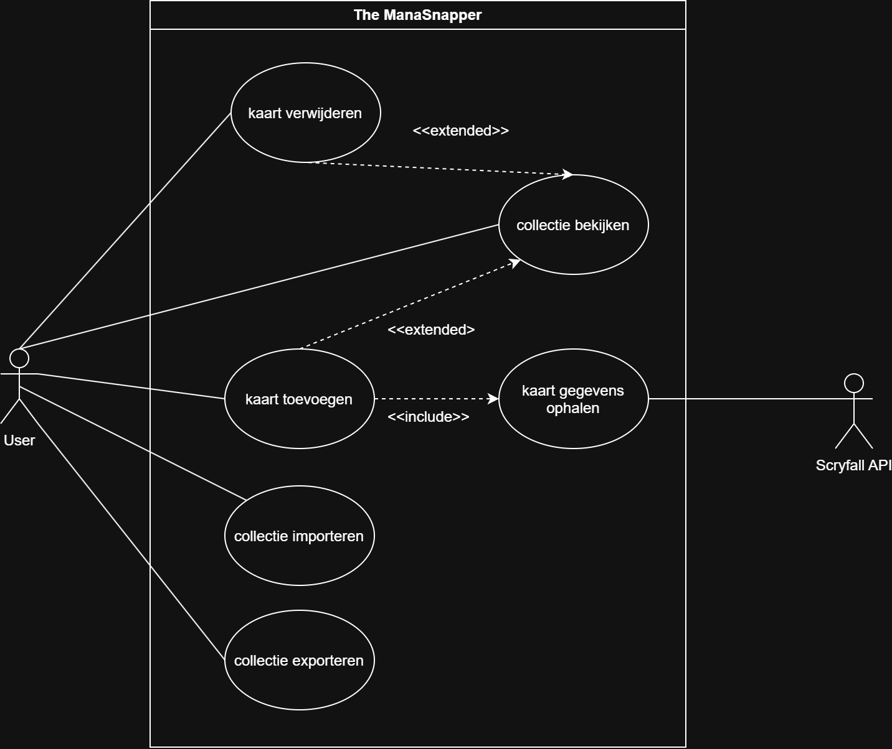
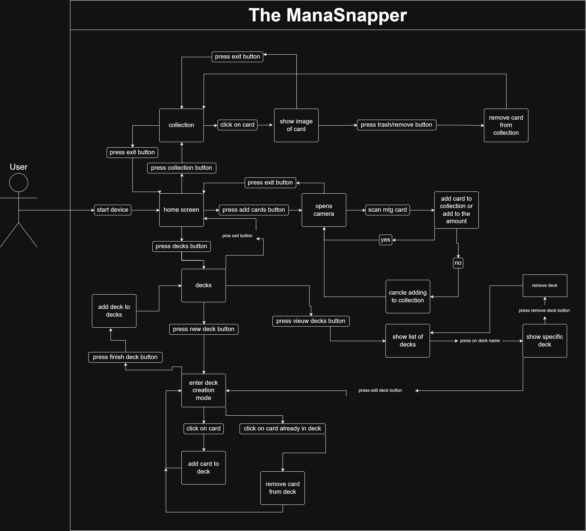
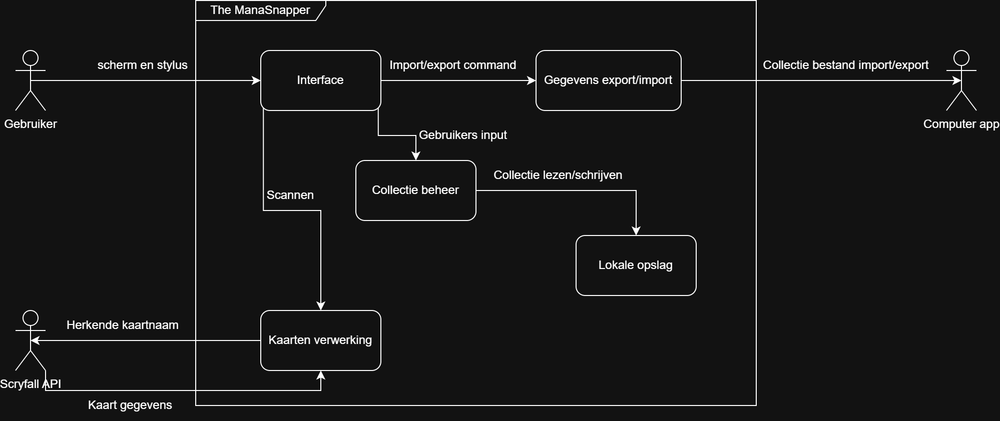
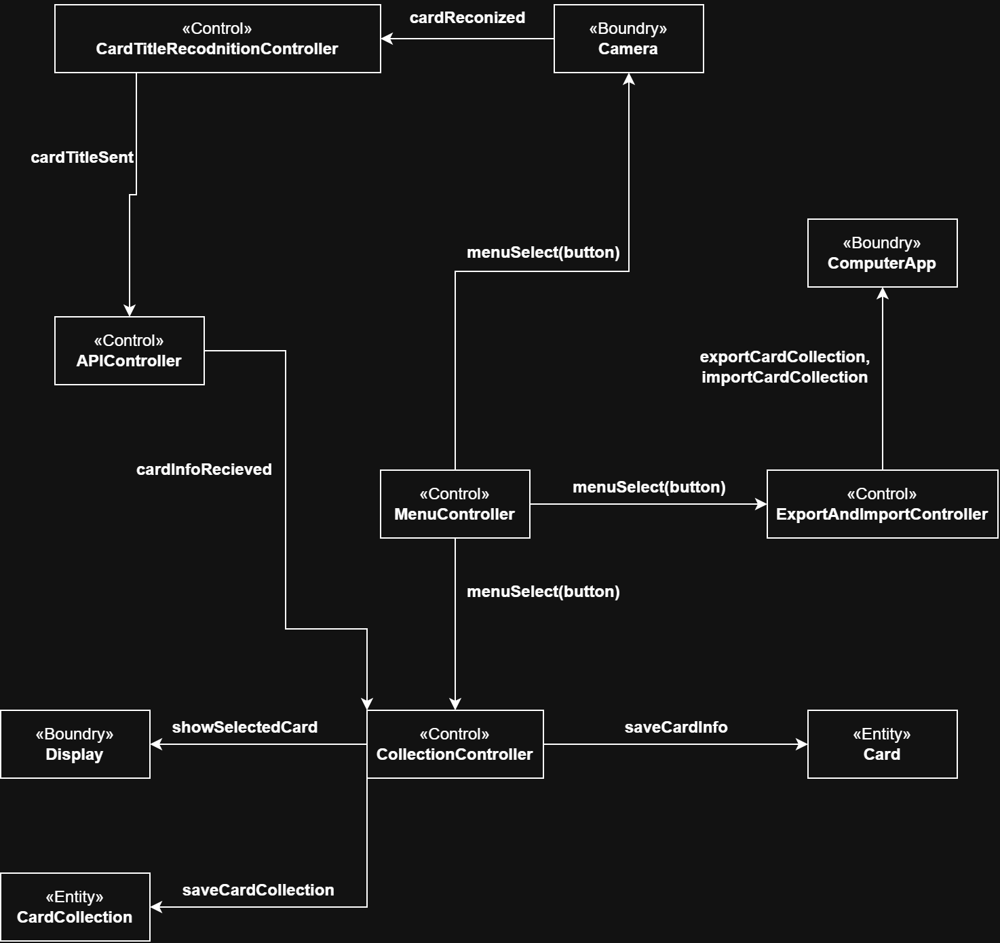
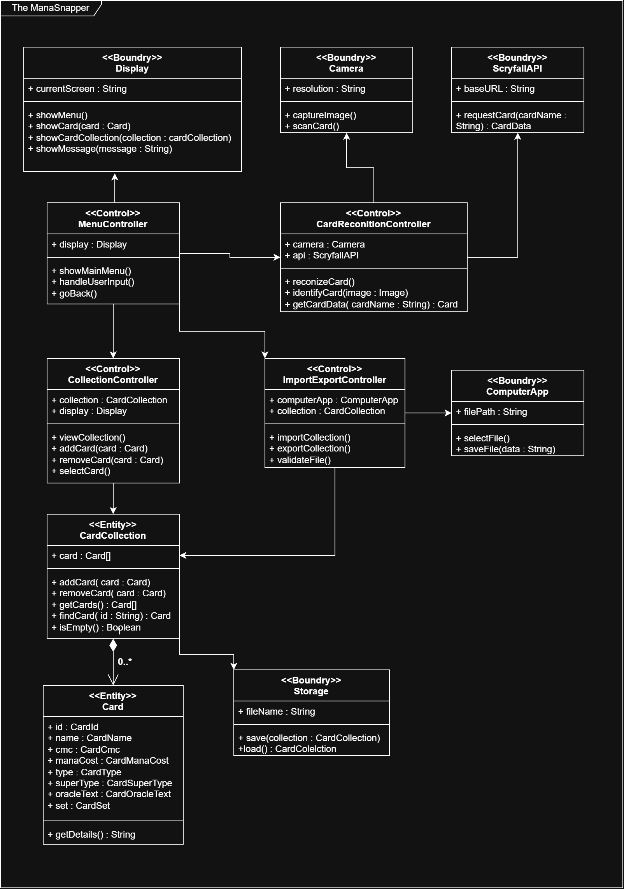
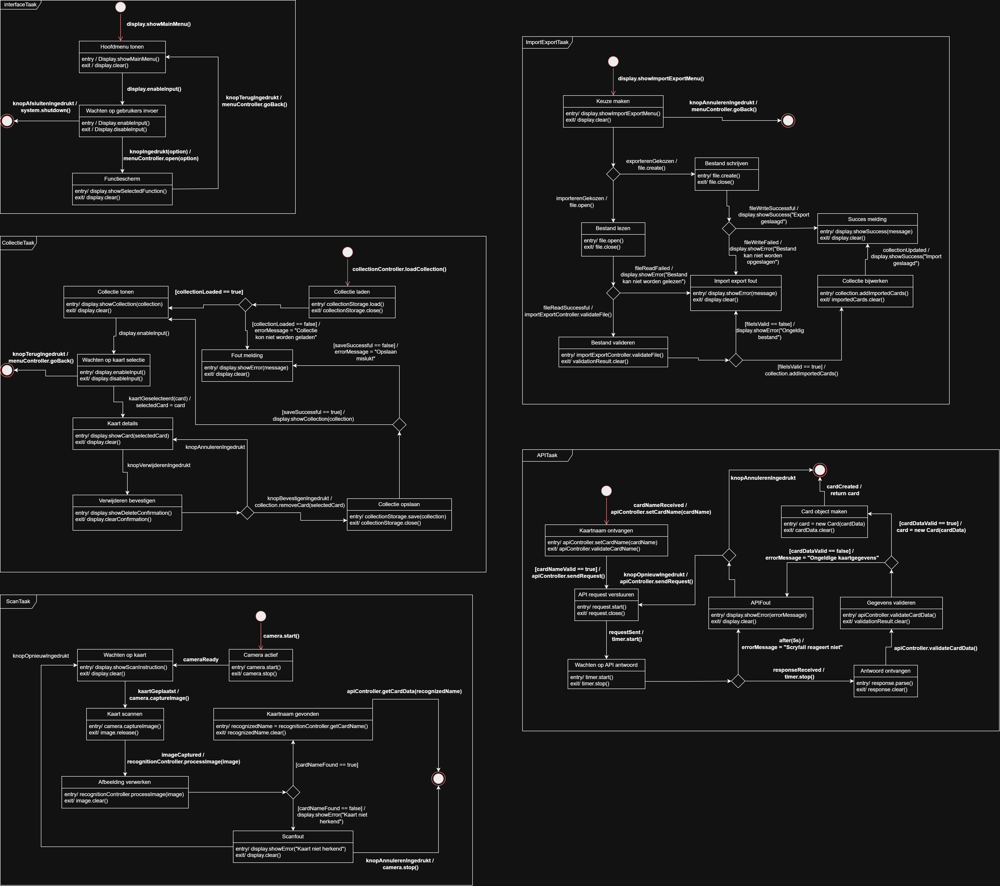

# Ontwikkeldocument Project The ManaSnapper

Versie 0.0.1

Team: The ManaEngineer

## Inhoudsopgave

- [Ontwikkeldocument Project The ManaSnapper](#ontwikkeldocument-project-projectnaam)
  - [Inhoudsopgave](#inhoudsopgave)
  - [Inleiding](#inleiding)
  - [Leeswijzer](#leeswijzer)
  - [Uitgangspunten](#uitgangspunten)
    - [Systeem Context](#systeem-context)
    - [Identificatie en prioritering van Key Drivers](#identificatie-en-prioritering-van-key-drivers)
  - [Requirements](#requirements)
    - [Functionele Requirements](#functionele-requirements)
    - [Niet-Functionele Requirements](#niet-functionele-requirements)
    - [Constraints](#constraints)
    - [Use Cases](#use-cases)
    - [Activity Diagrammen](#activity-diagrammen)
  - [Ontwerp](#ontwerp)
    - [Functionele decompositie / (sub)systems and interfaces](#functionele-decompositie--subsystems-and-interfaces)
    - [Objectmodellen](#objectmodellen)
      - [Lijst met Objecten](#lijst-met-objecten)
    - [Taakstructurering](#taakstructurering)
      - [Taaksoort en deadline](#taaksoort-en-deadline)
      - [Taken samenvoegen](#taken-samenvoegen)
    - [Klassediagrammen](#klassediagrammen)
    - [STD's](#stds)
  - [Realisatie](#realisatie)
    - [Fysieke View](#fysieke-view)
    - [Code](#code)
    - [Unit Tests](#unit-tests)
    - [Integratie Tests](#integratie-tests)
    - [Eindresultaat](#eindresultaat)
  - [Conclusie en Advies](#conclusie-en-advies)
  - [Appendices](#appendices)
    - [Appendix 1: Mindmaps](#appendix-1-mindmaps)
    - [Appendix 2: Gespreksverslagen](#appendix-2-gespreksverslagen)
      - [Notities bij Kickoff-Meeting](#notities-bij-kickoff-meeting)
    - [Appendix 3: Upgradeonderzoeksverslagen](#appendix-3-upgradeonderzoeksverslagen)
    - [Appendix 4: Referenties](#appendix-4-referenties)

## Inleiding

Het doel van het project is het maken van **The ManaSnapper**. een draagbaar apparaat waarmee gebruikers fysieke kaarten kunnen scannen en beheren in een digitale collectie. Het apparaat beschikt hiervoor over een camera en een scherm met een stylus. Na het herkennen van een kaart worden de bijbehorende kaartgegevens opgehaald, waarna de gebruiker de kaart aan de collectie kan toevoegen, de collectie kan bekijken of kaarten kan verwijderen.

Naast het fysieke apparaat wordt een computer app voorzien. De collectie kan tussen het apparaat en de applicatie worden geïmporteerd en geëxporteerd, zodat de gebruiker de kaartgegevens ook op een computer kan beheren. In de verdere uitwerking zijn onder andere het maken en beheren van decks, het testen van decks, een kaart van de dag en mogelijke uitbreidingen. De MVP richt zich op het fyzieke apperaat en de data kunnen overzetten op de computer (zonder app).

## Leeswijzer

Dit ontwikkeldocument beschrijft de ontwikkeling van The ManaSnapper van aanleiding en uitgangspunten tot ontwerp, realisatie en evaluatie.

In het hoofdstuk **Uitgangspunten** wordt beschreven welke uitgangspunten de basis vormen voor de requirements. Hierbij worden de systeemcontext, de betrokken stakeholders en de belangrijkste key drivers van The ManaSnapper behandeld.

In het hoofdstuk **Requirements** wordt beschreven wat The ManaSnapper moet kunnen en aan welke voorwaarden het systeem moet voldoen. De functionele en niet-functionele requirements, constraints en use cases vormen samen de basis voor het ontwerp.

In het hoofdstuk **Ontwerp** wordt uitgewerkt hoe The ManaSnapper wordt opgebouwd om aan de requirements te voldoen. De functionele decompositie beschrijft de hoofdonderdelen en hun interfaces, waarna de objectmodellen, taakstructurering, klassediagrammen en state transition diagrams de samenwerking, verwerking en toestanden van deze onderdelen verder uitwerken.

``leg uit wat er in de hoogste-niveau-hoofdstukken wordt behandeld en hoe deze onderwerpen met elkaar in verband staan``

``zal gemaakt worden per hoofdstuk zodra ze klaar zijn - wouter``

## Uitgangspunten

Dit hoofdstuk beschrijft de uitgangspunten voor de requirements van The ManaSnapper. Hierbij worden de systeemcontext, de systeemgrenzen, de betrokken stakeholders en de belangrijkste key drivers behandeld. Deze uitgangspunten zijn gebaseerd op de projectinformatie en de input van de opdrachtgevers.

### Systeem Context

The ManaSnapper is het systeem binnen de systeemgrens. Het systeem bestaat uit het fysieke apparaat en de bijbehorende functionaliteit voor het beheren van kaartgegevens. De gebruiker bedient The ManaSnapper, voert keuzes in en biedt fysieke kaarten aan om te scannen. 

The ManaSnapper gebruikt Scryfall als externe bron voor kaartgegevens via de gratis api. Nadat een kaart is herkend, worden de bijbehorende gegevens uit Scryfall opgehaald en gebruikt binnen de collectie.

Daarnaast wisselt The ManaSnapper collectiegegevens uit met de computer app. Hierdoor kan de gebruiker een collectie vanaf het apparaat naar de app exporteren en bestaande collectiegegevens vanuit de app importeren.

### Identificatie en prioritering van Key Drivers

| Prioriteit | Key driver | Stakeholder | Omschrijving |
|---|---|---|---|
| 1 | Controle over de collectie | Gebruiker, opdrachtgever | De gebruiker moet zelf kunnen bepalen welke kaarten in de collectie staan. Kaarten kunnen daarom bewust worden toegevoegd, bekeken en verwijderd. |
| 2 | Betrouwbare kaartgegevens | Gebruiker, opdrachtgever | Een fysieke kaart moet correct worden herkend en de bijbehorende gegevens moeten betrouwbaar uit Scryfall worden opgehaald. Bij een mislukte herkenning of ontbrekende gegevens moet het systeem dit duidelijk melden. |
| 3 | Inzicht in de collectie | Gebruiker, klant | De gebruiker moet op ieder moment kunnen zien welke kaarten in de collectie staan en de gegevens van deze kaarten kunnen controleren. |
| 4 | Behoud en bereikbaarheid van de collectie | Gebruiker, opdrachtgever | Wijzigingen in de collectie moeten correct worden opgeslagen en de collectie moet tussen The ManaSnapper en de computerapplicatie kunnen worden uitgewisseld. Hierdoor houdt de gebruiker ook op verschillende apparaten controle over dezelfde collectie. |

## Requirements

Dit hoofdstuk beschrijft wat The ManaSnapper moet kunnen en aan welke voorwaarden het moet voldoen. De functionele requirements beschrijven het gedrag, de niet-functionele requirements de kwaliteit, de constraints de ontwerpgrenzen en de use cases de interactie met de gebruiker. Samen vormen deze onderdelen de basis voor het ontwerp van The ManaSnapper.

### Functionele Requirements

| Naam | Omschrijving | Rationale | Business prioriteit |
|---|---|---|---|
| **F01 - Navigeren door het systeem** | Het systeem toont een hoofdmenu waaruit de beschikbare functies kunnen worden gestart. Vanuit iedere functie kan het systeem via een terugknop of annuleeractie terugkeren naar het hoofdmenu of het bijbehorende bovenliggende menu. | Een duidelijke navigatiestructuur maakt het mogelijk om de collectie doelgericht te bekijken en te beheren. | **Must** |
| **F02 - Kaart identificeren** | Het systeem gebruikt de camera om een aangeboden fysieke kaart te scannen en de kaartnaam te identificeren. | Een correcte identificatie is nodig om te bepalen welke kaart aan de collectie wordt toegevoegd en ondersteunt de key driver **Betrouwbare kaartgegevens**. | **Must** |
| **F03 - Kaartgegevens ophalen** | Het systeem zoekt de geïdentificeerde kaart op via de Scryfall API en ontvangt de bijbehorende kaartgegevens. | Betrouwbare kaartgegevens zijn nodig om een kaart correct te tonen en aan de collectie toe te voegen. Dit ondersteunt de key driver **Betrouwbare kaartgegevens**. | **Must** |
| **F04 - Kaartgegevens tonen** | Het systeem toont de opgehaalde kaartgegevens en biedt de mogelijkheid om het toevoegen aan de collectie te bevestigen of te annuleren. | De gebruiker moet kunnen controleren of de herkende kaart juist is voordat de collectie wordt gewijzigd. | **Must** |
| **F05 - Kaart aan collectie toevoegen** | Het systeem voegt een bevestigde kaart toe aan de collectie en slaat de bijgewerkte collectie op. | De gebruiker bepaalt hiermee welke kaarten onderdeel zijn van de collectie. Dit ondersteunt de key driver **Controle over de collectie**. | **Must** |
| **F06 - Collectie bekijken** | Het systeem toont de opgeslagen kaarten in de collectie en kan de details van een geselecteerde kaart tonen. | De gebruiker moet de opgeslagen collectie kunnen controleren en beheren. | **Must** |
| **F07 - Kaart uit collectie verwijderen** | Het systeem verwijdert een geselecteerde kaart pas na bevestiging en slaat de bijgewerkte collectie op. | De gebruiker moet de collectie kunnen beheren en ongewenste kaarten kunnen verwijderen. | **Must** |
| **F08 - Collectie importeren** | Het systeem leest een geldig collectiebestand vanaf een computer in, controleert het bestand en voegt de kaartgegevens toe aan de collectie. | Importeren zorgt ervoor dat de gebruiker een bestaande collectie kan blijven beheren en ondersteunt de key driver **Behoud en bereikbaarheid van de collectie**. | **Should** |
| **F09 - Collectie exporteren** | Het systeem zet de collectie om naar een ondersteund bestandsformaat en slaat het bestand op een gekozen locatie op de computer op. | Exporteren maakt het mogelijk om een back-up te bewaren en de collectie op een computer te gebruiken. | **Should** |
| **F10 - Fouten en resultaten melden** | Het systeem toont een duidelijke melding wanneer een handeling succesvol is afgerond, wordt geannuleerd of niet kan worden uitgevoerd. De bestaande collectie blijft ongewijzigd wanneer een bewerking mislukt. | Duidelijke feedback voorkomt onbedoelde wijzigingen en ondersteunt de key driver **Controle over de collectie**. | **Must** |

### Niet-Functionele Requirements

| Naam | Omschrijving | Rationale | Business prioriteit |
|---|---|---|---|
| **NF01 - Betrouwbaarheid** | Bij een mislukte kaartidentificatie, ontbrekende kaartgegevens of een niet-bereikbaar extern systeem toont The ManaSnapper een foutmelding en blijft de bestaande collectie ongewijzigd. | De gebruiker moet erop kunnen vertrouwen dat een fout niet leidt tot verkeerde of verloren kaartgegevens. | **Must** |
| **NF02 - Gegevensbehoud** | Na het succesvol toevoegen of verwijderen van een kaart worden de wijzigingen opgeslagen voordat het systeem de handeling als voltooid meldt. | Hierdoor blijven wijzigingen behouden en raakt de collectie niet ongemerkt verouderd. | **Must** |
| **NF03 - Gebruiksvriendelijkheid** | Iedere functie toont duidelijk welke actie beschikbaar is en bevat een zichtbare terug- of annuleeractie waarmee de gebruiker naar het hoofdmenu of het bovenliggende menu kan terugkeren. | Dit ondersteunt eenvoudige bediening en voorkomt dat de gebruiker vast komt te zitten in een scherm. | **Must** |
| **NF04 - Prestaties** | Het systeem toont binnen 3 seconden een reactie nadat de gebruiker een menuoptie of knop heeft geselecteerd, exclusief de tijd die nodig is voor een externe Scryfall-aanvraag. | Een snelle reactie maakt de bediening begrijpelijk en voorkomt dat de gebruiker opnieuw op een knop drukt. | **Should** |
| **NF05 - Foutmeldingen** | Foutmeldingen beschrijven in begrijpelijke taal wat er is misgegaan en geven aan wat de gebruiker vervolgens kan doen. | De gebruiker moet problemen kunnen herkennen en zelfstandig kunnen herstellen of terugkeren naar het hoofdmenu. | **Must** |
| **NF06 - Draagbaarheid** | Het fysieke apparaat kan zonder permanente aansluiting op een computer worden gebruikt en beschikt over een oplaadbare voeding. | Hierdoor kan de gebruiker de collectie ook buiten de computer beheren en blijft de collectie bereikbaar. | **Must** |
| **NF07 - Gegevensuitwisseling** | Geëxporteerde collectiegegevens kunnen door de computerapplicatie worden ingelezen en geïmporteerde geldige collectiegegevens kunnen door The ManaSnapper worden gebruikt. | De collectie moet tussen het apparaat en de computer kunnen worden uitgewisseld zonder handmatige omzetting van kaartgegevens. | **Should** |
| **NF08 - Uitbreidbaarheid** | De softwarestructuur scheidt kaartidentificatie, externe kaartgegevens, collectiebeheer en gebruikersinterface, zodat toekomstige functies kunnen worden toegevoegd zonder de bestaande kernfunctionaliteiten opnieuw te ontwerpen. | Een duidelijke scheiding houdt het beheer van de collectie betrouwbaar wanneer later extra functies worden toegevoegd. | **Could** |

### Constraints

| Naam | Omschrijving | Rationale |
|---|---|---|
| **C01 - Bediening via het apparaat** | De gebruiker bedient het fysieke apparaat via het scherm en een stylus. De MVP vereist geen toetsenbord, muis of permanente bediening vanaf een computer. | The ManaSnapper moet als draagbaar zelfstandig apparaat kunnen functioneren. De gekozen interface en navigatie moeten daarom op het scherm uitvoerbaar zijn. |
| **C02 - Oplaadbare voeding** | Het apparaat gebruikt een oplaadbare 18650-batterij met de aanwezige TP4056-laadmodule en moet zonder permanente aansluiting op een computer kunnen werken. | Draagbaarheid is een uitgangspunt van het product. De voeding mag daarom niet afhankelijk zijn van een vaste USB- of computerverbinding tijdens normaal gebruik. |
| **C03 - Lokale opslag** | De collectie wordt lokaal op het apparaat opgeslagen via de microSD-module. De oplossing moet rekening houden met de eindige opslagcapaciteit en met het behoud van geldige collectiegegevens bij het uitschakelen van het apparaat. | Het apparaat moet kaarten kunnen bewaren zonder dat de gebruiker voortdurend online of met een computer verbonden is. De beschikbare opslag bepaalt tegelijk de maximale omvang van de collectie. |
| **C04 - Afhankelijkheid van Scryfall** | Voor kaartgegevens wordt de gratis Scryfall API gebruikt. Kaartgegevens kunnen alleen automatisch worden opgehaald wanneer de API bereikbaar is en de aanvraag binnen de voorwaarden en limieten van die API valt. | Het project gebruikt Scryfall als externe bron en ontwikkelt geen eigen volledige kaartdatabase. Een storing, netwerkprobleem of limiet van Scryfall mag daarom niet als lokale kaartdata worden behandeld. |
| **C05 - Eenduidig gegevensformaat** | Import en export gebruiken hetzelfde vooraf vastgelegde tekst- of databaseformaat, inclusief een herkenbare representatie van de kaartgegevens. Ongeldige of onbekende bestanden mogen niet in de collectie worden verwerkt. | Gegevens moeten zonder handmatige omzetting tussen het apparaat en de computer kunnen worden uitgewisseld. Een vast formaat voorkomt dat beide kanten verschillende interpretaties van dezelfde collectie gebruiken. |

### Use Cases

#### use case diagram

#### use cases

| Naam | Beschrijving | Pre-condities | Scenario | Post-condities | Uitzonderingen |
|---|---|---|---|---|---|
| **UC01 - Collectie bekijken** | Het systeem toont de opgeslagen kaarten in de collectie. | Het systeem kan de collectie openen. | 1. Het systeem opent de collectie.   2. Het systeem haalt de opgeslagen kaarten op.   3. Het systeem geeft de kaarten weer.   4. Het systeem wacht totdat een kaart wordt geselecteerd of totdat terugkeren naar het hoofdmenu (back button op scherm) wordt gekozen.   5. Het systeem toont de geselecteerde kaart in meer detail en wacht totdat de terug nop word geraakt (X button op scherm).   6. Het systeem keert terug naar de collection menu. | De kaarten uit de collectie zijn weergegeven en het systeem keert terug naar het hoofdmenu. | Als de collectie geen kaarten bevat, toont het systeem een melding dat de collectie leeg is en keert het systeem terug naar het hoofdmenu. Als de collectie niet kan worden ingelezen, toont het systeem een foutmelding en keert het systeem terug naar het hoofdmenu. |
| **UC02 - Kaart toevoegen** | Het systeem voegt een kaart aan de collectie toe. | Het systeem kan de collectie aanpassen. | 1. Het systeem wacht totdat een kaart wordt opgegeven.   2. Het systeem identificeert de kaart naam.   3. Het systeem haalt de kaartgegevens op.   4. Het systeem toont de opgehaalde kaartgegevens.   5. Het systeem wacht op bevestiging om de kaart toe te voegen of op de keuze om terug te keren naar het hoofdmenu.   6. Het systeem voegt de kaart aan de collectie toe.   7. Het systeem slaat de bijgewerkte collectie op.   8. Het systeem keert terug naar het hoofdmenu. | De gescande of gekozen kaart is toegevoegd en het systeem keert terug naar het hoofdmenu. | Als het systeem geen kaart kan identificeren, toont het systeem een melding dat de kaart niet herkend is en keert het systeem terug naar het hoofdmenu. Als het systeem de kaartgegevens niet kan ophalen, toont het systeem een melding dat de kaart niet gevonden is en keert het systeem terug naar het hoofdmenu. Als het toevoegen wordt geannuleerd, voegt het systeem de kaart niet toe en keert het systeem terug naar het hoofdmenu. |
| **UC03 - Kaart verwijderen** | Het systeem verwijdert een kaart uit de collectie. | Het systeem toont de collectie. | 1. Het systeem toont de kaarten uit de collectie.   2. Het systeem wacht totdat een kaart wordt geselecteerd of totdat terugkeren naar het hoofdmenu wordt gekozen.   3. Het systeem toont de geselecteerde kaart met een back en een verwijder button.   4. Het systeem vraagt om bevestiging voor het verwijderen.   5. Het systeem wacht op bevestiging.   6. Het systeem verwijdert de geselecteerde kaart uit de collectie.   7. Het systeem slaat de bijgewerkte collectie op.   8. Het systeem toont de bijgewerkte collectie.   9. Het systeem keert terug naar het hoofdmenu. | De geselecteerde kaart is verwijderd en het systeem keert terug naar het hoofdmenu. | Als het verwijderen wordt geannuleerd, laat het systeem de kaart in de collectie staan en keert het systeem terug naar het hoofdmenu. Als de geselecteerde kaart niet meer in de collectie staat, toont het systeem een foutmelding, blijft de collectie ongewijzigd en keert het systeem terug naar het hoofdmenu. |
| **UC04 - Kaartgegevens ophalen** | Het systeem haalt de gegevens van een kaart op uit Scryfall. | Het systeem heeft een kaart geïdentificeerd en beschikt over de benodigde kaartinformatie. | 1. Het systeem ontvangt de kaart naam.   2. Het systeem zoekt de kaart op bij Scryfall.   3. Het systeem ontvangt de kaartgegevens.   4. Het systeem stelt de kaartgegevens beschikbaar aan de aanroepende use case.   5. Na afronding of beëindiging keert het systeem terug naar het hoofdmenu. | De gegevens van de kaart zijn ontvangen en beschikbaar om aan de collectie toe te voegen. Daarna keert het systeem terug naar het hoofdmenu of naar de aanroepende use case. | Als Scryfall geen kaart met de opgegeven gegevens vindt, toont het systeem een melding dat de kaart niet gevonden is en keert het systeem terug naar het hoofdmenu. Als Scryfall niet bereikbaar is, toont het systeem een melding dat de kaartgegevens niet opgehaald kunnen worden en keert het systeem terug naar het hoofdmenu. Als de ontvangen kaartgegevens ongeldig zijn, voegt het systeem de gegevens niet toe aan de collectie en keert het systeem terug naar het hoofdmenu. |
| **UC05 - Collectie importeren** | Het systeem importeert een bestaande collectie vanaf de computer. | Het systeem kan een collectiebestand openen. | 1. Het systeem wacht totdat een collectiebestand wordt geselecteerd of totdat terugkeren naar het hoofdmenu wordt gekozen.   2. Het systeem leest het geselecteerde bestand in.   3. Het systeem controleert de inhoud van het bestand.   4. Het systeem voegt de kaarten uit het bestand toe aan de collectie.   5. Het systeem slaat de bijgewerkte collectie op.   6. Het systeem meldt dat de collectie succesvol is geïmporteerd.   7. Het systeem keert terug naar het hoofdmenu. | De kaarten uit het geïmporteerde bestand zijn opgeslagen in de collectie en het systeem keert terug naar het hoofdmenu. | Als geen bestand wordt geselecteerd, annuleert het systeem de import en keert het systeem terug naar het hoofdmenu. Als het bestand niet kan worden gelezen, toont het systeem een foutmelding, laat het systeem de bestaande collectie ongewijzigd en keert het systeem terug naar het hoofdmenu. Als het bestand geen geldig collectieformaat bevat, toont het systeem een foutmelding, past het systeem de collectie niet aan en keert het systeem terug naar het hoofdmenu. |
| **UC06 - Collectie exporteren** | Het systeem exporteert de opgeslagen collectie naar de computer. | Het systeem beschikt over een collectie die kan worden geëxporteerd. | 1. Het systeem haalt de collectie op.   2. Het systeem wacht totdat een locatie en bestandsnaam worden opgegeven of totdat terugkeren naar het hoofdmenu wordt gekozen.   3. Het systeem zet de collectie om naar het gekozen bestandsformaat.   4. Het systeem slaat het bestand op de computer op.   5. Het systeem meldt dat de collectie succesvol is geëxporteerd.   6. Het systeem keert terug naar het hoofdmenu. | De collectie is opgeslagen in een bestand op de computer en het systeem keert terug naar het hoofdmenu. | Als geen locatie wordt geselecteerd, annuleert het systeem de export en keert het systeem terug naar het hoofdmenu. Als het bestand niet kan worden opgeslagen, toont het systeem een foutmelding en keert het systeem terug naar het hoofdmenu. Als de collectie leeg is, meldt het systeem dat er geen kaarten zijn om te exporteren en keert het systeem terug naar het hoofdmenu. |

### Activity Diagrammen

## Ontwerp

Dit hoofdstuk vertaalt de requirements naar een technische structuur voor The ManaSnapper. Eerst wordt met de functionele decompositie bepaald welke subsystemen en interfaces nodig zijn. Daarna worden deze onderdelen uitgewerkt in objectmodellen, taken, klassediagrammen en state transition diagrams, waarbij elk onderdeel voortbouwt op het vorige en samen de basis vormt voor de realisatie.

### Functionele decompositie / (sub)systems and interfaces

### Objectmodellen

#### Lijst met Objecten

| Object Naam | Stereotype | Beschrijving |
|---|---|---|
| **MenuController** | Control | Verwerkt de menukeuzes van de gebruiker en start de bijbehorende functionaliteit. |
| **CardTitleRecognitionController** | Control | Verwerkt de herkenning van een kaarttitel. |
| **APIController** | Control | Verzorgt het ophalen en verwerken van kaartgegevens via een externe API. |
| **CollectionController** | Control | Beheert het bekijken, toevoegen en verwijderen van kaarten in de collectie. |
| **ExportAndImportController** | Control | Verzorgt het importeren en exporteren van collectiegegevens. |
| **Camera** | Boundary | Legt beelden van een fysieke kaart vast. |
| **Display** | Boundary | Toont menu's, kaartgegevens en meldingen aan de gebruiker. |
| **ComputerApp** | Boundary | Biedt een extern systeem voor het ontvangen en aanleveren van collectiegegevens. |
| **Card** | Entity | Bevat de gegevens van één kaart. |
| **CardCollection** | Entity | Bevat de opgeslagen kaarten en vertegenwoordigt de collectie. |

### Taakstructurering

Taakstructurering beschrijft wanneer de objecten uit het objectmodel actief
worden en hoeveel tijd zij voor hun taak mogen gebruiken. Hierdoor wordt
duidelijk welke onderdelen direct op gebruikersinput reageren en welke
onderdelen op de achtergrond of op vaste momenten werken. De taaksoort en
deadline worden eerst per object bepaald. Daarna kunnen taken die dezelfde
soort verwerking uitvoeren worden samengevoegd tot één taak.

#### Taaksoort en deadline

| Object Naam | Taaksoort | Periode | Deadline | Prioriteit |
|---|---|---|---|---|
| **MenuController** | Demand Driven | n.v.t. | 100 ms | 1 |
| **Display** | Demand Driven | n.v.t. | 100 ms | 1 |
| **CollectionController** | Demand Driven | n.v.t. | 500 ms | 2 |
| **Camera** | Demand Driven | n.v.t. | 1 s | 3 |
| **CardTitleRecognitionController** | Demand Driven | n.v.t. | 3 s | 4 |
| **ExportAndImportController** | Demand Driven | n.v.t. | 3 s | 4 |
| **APIController** | Demand Driven | n.v.t. | 5 s | 5 |
| **ComputerApp** | Demand Driven | n.v.t. | 5 s | 5 |
| **Card** | Geen eigen taak | n.v.t. | n.v.t. | n.v.t. |
| **CardCollection** | Geen eigen taak | n.v.t. | n.v.t. | n.v.t. |

#### Taken samenvoegen

| Taak Naam | Objecten | Taaksoort | Periode | Deadline | Prioriteit |
|---|---|---|---|---|---|
| **InterfaceTaak** | **MenuController**, Display | Demand Driven | n.v.t. | 100 ms | 1 |
| **CollectieTaak** | **CollectionController**, Card, CardCollection | Demand Driven | n.v.t. | 500 ms | 2 |
| **ScanTaak** | **CardTitleRecognitionController**, Camera | Demand Driven | n.v.t. | 3 s | 3 |
| **ImportExportTaak** | **ExportAndImportController**, ComputerApp | Demand Driven | n.v.t. | 3 s | 3 |
| **APITaak** | **APIController** | Demand Driven | n.v.t. | 5 s | 4 |

### Klassediagrammen

### STD's

## Realisatie

``leg uit waarin de realisatie zich onderscheidt van het ontwerp, en noem kort de rollen van de subhoofdstukken``

### Fysieke View

``Ontwerp de fysieke decompositie (een SysML Bdd). (de functionele decompositie biedt daarvoor meestal goede aanknopingspunten). Verduidelijk fysieke compositie-relaties middels "Constraints" (NB: dat zijn in dit geval gekwantificeerde ontwerpkeuzes die zowel uit de eerdere constraints als de niet-functionele requirements bestaan.``

### Code

``Ontwerp vanuit de STD's de bijbehorende code. Geef waar nodig additionele toelichting. Voeg per STD een link toe naar de betreffende code in de team repo. Voeg ook links naar de overige code toe``

### Unit Tests

``Voeg in dit hoofdstuk sub-hoofdstukken toe met Unit Tests, elk bestaande uit een Testplan, een link naar de testcode, een samenvatting van de bevindingen van de meest recente uitvoer van die test en een link naar een bestand met die meest recente test-output.``

### Integratie Tests

``Voeg in dit hoofdstuk sub-hoofdstukken toe met Integratie Tests, elk bestaande uit een Testplan, een link naar de testcode, een samenvatting van de bevindingen van de meest recente uitvoer van die test en een link naar een bestand met die meest recente test-output. Belangrijke integratie-tests zijn uiteraard ook de tests van het complete product. Hoe goed doet het product wat het moet doen?``

``Verder zou je in dit hoofdstuk Realisatie ook subhoofdstukken kunnen opnemen met : beslissingstabellen, waarin gemaakte realisatiekeuzes worden verantwoord, Failure Mode Effect Analyses, en andere realisatie gerelateerde overwegingen.``

### Eindresultaat

`` Nog eens op een rijtje de behaalde functionaliteiten en de performance. ``

## Conclusie en Advies

`` Reflecteer op in welke mate de aanvankelijk opgestelde requirements daadwerkelijk zijn behaald. Geef goed onderbouwde aanbevelingen t.a.v. mogelijke toekomstige doorontwikkeling.`` 

## Appendices

### Appendix 1: Mindmaps

`` Bijvoorbeeld voorafgaand aan het maken van het systeem context diagram is een mooi moment om met zijn allen een mindmap te maken die een samenhang duidt van alles wat je als team maar kunt bedenken in relatie tot het systeem. ``

### Appendix 2: Gespreksverslagen

#### Notities bij Kickoff-Meeting

``... etc``

### Appendix 3: Upgradeonderzoeksverslagen

``zet hier een lijst met links naar de upgradeonderzoeksverslagen. Licht het toe met wat tekst met de belangrijkste samenvatttingen ervan.``

### Appendix 4: Referenties

`` lijst 3rd party materiaal waar naar verwezen is. Boeken, site-links.``

`` Verder mogelijk nog appendices over: de geschiedenis van de ontwikkeling van het product in grote lijnen (inclusief inmiddels afgeschoten tussenproducten), over het opzetten van de ontwikkelomgevingen, over hoe te debuggen. Houdt het bij samenvattende dingen. Lange teksten (zoals testuitvoer) niet in de appendices maar via links naar bestanden opnemen.``
