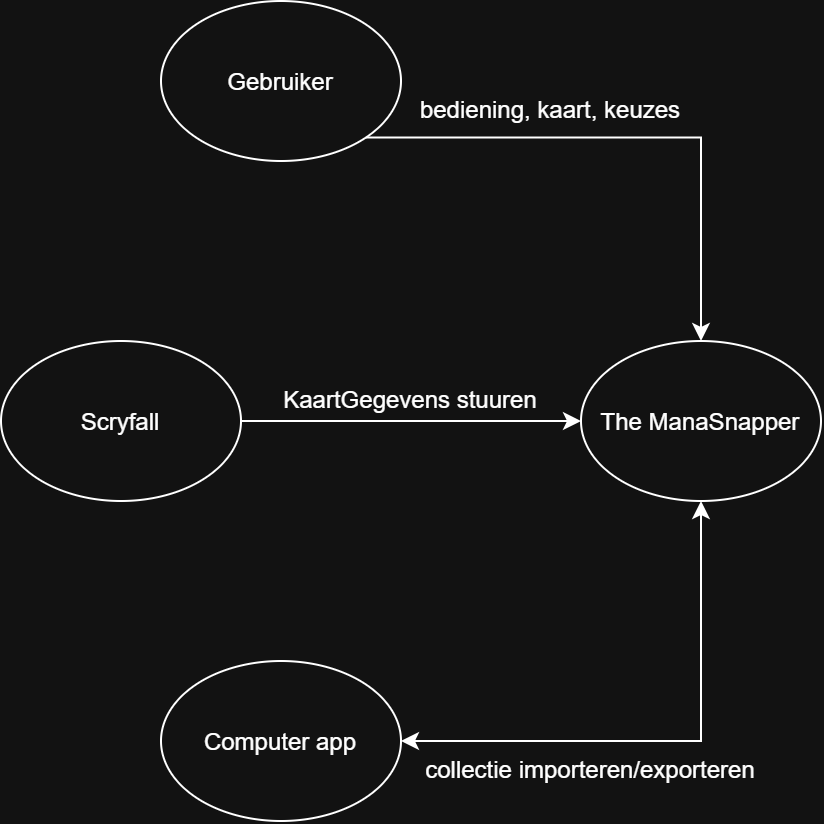

# Ontwikkeldocument Project The ManaSnapper

Versie 0.0.1

Team: The ManaEngineer

## Inhoudsopgave

- [Ontwikkeldocument Project The ManaSnapper](#ontwikkeldocument-project-projectnaam)
  - [Inhoudsopgave](#inhoudsopgave)
  - [Inleiding](#inleiding)
  - [Leeswijzer](#leeswijzer)
  - [Uitgangspunten](#uitgangspunten)
    - [Systeem Context](#systeem-context)
    - [Identificatie en prioritering van Key Drivers](#identificatie-en-prioritering-van-key-drivers)
  - [Requirements](#requirements)
    - [Functionele Requirements](#functionele-requirements)
    - [Niet-Functionele Requirements](#niet-functionele-requirements)
    - [Constraints](#constraints)
    - [Use Cases](#use-cases)
    - [Activity Diagrammen](#activity-diagrammen)
  - [Ontwerp](#ontwerp)
    - [Functionele decompositie / (sub)systems and interfaces](#functionele-decompositie--subsystems-and-interfaces)
    - [Objectmodellen](#objectmodellen)
      - [Lijst met Objecten](#lijst-met-objecten)
    - [Taakstructurering](#taakstructurering)
      - [Taaksoort en deadline](#taaksoort-en-deadline)
      - [Taken samenvoegen](#taken-samenvoegen)
    - [Klassediagrammen](#klassediagrammen)
    - [STD's](#stds)
  - [Realisatie](#realisatie)
    - [Fysieke View](#fysieke-view)
    - [Code](#code)
    - [Unit Tests](#unit-tests)
    - [Integratie Tests](#integratie-tests)
    - [Eindresultaat](#eindresultaat)
  - [Conclusie en Advies](#conclusie-en-advies)
  - [Appendices](#appendices)
    - [Appendix 1: Mindmaps](#appendix-1-mindmaps)
    - [Appendix 2: Gespreksverslagen](#appendix-2-gespreksverslagen)
      - [Notities bij Kickoff-Meeting](#notities-bij-kickoff-meeting)
    - [Appendix 3: Upgradeonderzoeksverslagen](#appendix-3-upgradeonderzoeksverslagen)
    - [Appendix 4: Referenties](#appendix-4-referenties)

## Inleiding

Het doel van het project is het maken van **The ManaSnapper**. een draagbaar apparaat waarmee gebruikers fysieke kaarten kunnen scannen en beheren in een digitale collectie. Het apparaat beschikt hiervoor over een camera en een scherm met een stylus. Na het herkennen van een kaart worden de bijbehorende kaartgegevens opgehaald, waarna de gebruiker de kaart aan de collectie kan toevoegen, de collectie kan bekijken of kaarten kan verwijderen.

Naast het fysieke apparaat wordt een computer app voorzien. De collectie kan tussen het apparaat en de applicatie worden geïmporteerd en geëxporteerd, zodat de gebruiker de kaartgegevens ook op een computer kan beheren. In de verdere uitwerking zijn onder andere het maken en beheren van decks, het testen van decks, een kaart van de dag en mogelijke uitbreidingen. De MVP richt zich op het fyzieke apperaat en de data kunnen overzetten op de computer (zonder app).

## Leeswijzer

Dit ontwikkeldocument beschrijft de ontwikkeling van The ManaSnapper van aanleiding en uitgangspunten tot ontwerp, realisatie en evaluatie.

In het hoofdstuk **Uitgangspunten** wordt beschreven welke uitgangspunten de basis vormen voor de requirements. Hierbij worden de systeemcontext, de betrokken stakeholders en de belangrijkste key drivers van The ManaSnapper behandeld.

``leg uit wat er in de hoogste-niveau-hoofdstukken wordt behandeld en hoe deze onderwerpen met elkaar in verband staan``

``zal gemaakt worden per hoofdstuk zodra ze klaar zijn - wouter``

## Uitgangspunten

Dit hoofdstuk beschrijft de uitgangspunten voor de requirements van The ManaSnapper. Hierbij worden de systeemcontext, de systeemgrenzen, de betrokken stakeholders en de belangrijkste key drivers behandeld. Deze uitgangspunten zijn gebaseerd op de projectinformatie en de input van de opdrachtgevers.

### Systeem Context

The ManaSnapper is het systeem binnen de systeemgrens. Het systeem bestaat uit het fysieke apparaat en de bijbehorende functionaliteit voor het beheren van kaartgegevens. De gebruiker bedient The ManaSnapper, voert keuzes in en biedt fysieke kaarten aan om te scannen. 

The ManaSnapper gebruikt Scryfall als externe bron voor kaartgegevens via de gratis api. Nadat een kaart is herkend, worden de bijbehorende gegevens uit Scryfall opgehaald en gebruikt binnen de collectie.

Daarnaast wisselt The ManaSnapper collectiegegevens uit met de computer app. Hierdoor kan de gebruiker een collectie vanaf het apparaat naar de app exporteren en bestaande collectiegegevens vanuit de app importeren.

### Identificatie en prioritering van Key Drivers

| Prioriteit | Key driver | Stakeholder | Omschrijving |
|---|---|---|---|
| 1 | Werkende MVP | Opdrachtgever | De minimale versie van The ManaSnapper moet de afgesproken kernfunctionaliteiten bevatten: kaarten scannen, kaartgegevens ophalen, kaarten opslaan in een collectie, de collectie bekijken en kaarten verwijderen. |
| 2 | Betrouwbare kaartherkenning en kaartgegevens | Gebruiker, opdrachtgever | Een fysieke kaart moet correct herkend worden en de bijbehorende gegevens moeten betrouwbaar uit Scryfall worden opgehaald. Bij een mislukte herkenning of ontbrekende gegevens moet het systeem dit duidelijk melden. |
| 3 | Eenvoudige bediening | Gebruiker, klant | De gebruiker moet het apparaat en de computerapplicatie zonder onnodige complexiteit kunnen bedienen. De belangrijkste handelingen, zoals scannen, bekijken, toevoegen en verwijderen, moeten duidelijk en logisch verlopen. |
| 4 | Beheer van de collectie | Gebruiker, klant | De gebruiker moet de opgeslagen kaarten kunnen bekijken, toevoegen en verwijderen. De collectie moet na wijzigingen correct worden opgeslagen, zodat kaartgegevens niet onbedoeld verloren gaan. |
| 5 | Uitwisselbaarheid van gegevens | Gebruiker, opdrachtgever | Collectiegegevens moeten tussen The ManaSnapper en de computerapplicatie kunnen worden geïmporteerd en geëxporteerd. Hierdoor kan de gebruiker de collectie op beide systemen beheren en bewaren. |
| 6 | Draagbaarheid en zelfstandigheid | Gebruiker, klant | Het fysieke apparaat moet zelfstandig gebruikt kunnen worden en over een oplaadbare voeding beschikken. Hierdoor is de gebruiker niet voortdurend afhankelijk van een vaste computer of voedingskabel. |
| 7 | Uitbreidbaarheid | Opdrachtgever, klant | De opzet van het systeem moet toekomstige functies, zoals decks beheren, playtesten en een kaart van de dag, mogelijk maken zonder de basisfunctionaliteiten opnieuw te moeten ontwerpen. |

De werkende MVP staat bovenaan omdat het project zonder deze kernfunctionaliteiten zijn hoofddoel niet bereikt. Betrouwbare herkenning en eenvoudige bediening volgen daarna, omdat een apparaat pas waardevol is wanneer het de juiste kaartgegevens oplevert en begrijpelijk te gebruiken is. Collectiebeheer en gegevensuitwisseling ondersteunen de volledige gebruikersworkflow. Draagbaarheid en uitbreidbaarheid zijn belangrijk voor de kwaliteit en toekomstige waarde van het product, maar zijn voor de eerste MVP minder bepalend dan de kernfunctionaliteiten.

## Requirements

``leg uit hoe de requirements opgesteld worden door de samenhang te verwoorden van de onderwerpen uit de sub-hoofdstukken.``

### Functionele Requirements

| Naam | Omschrijving | Rationale | Business prioriteit |
|---|---|---|---|
| **F01 - Navigeren door het systeem** | Het systeem toont een hoofdmenu waaruit de beschikbare functies kunnen worden gestart. Vanuit iedere functie kan het systeem via een terugknop of annuleeractie terugkeren naar het hoofdmenu of het bijbehorende bovenliggende menu. | Een duidelijke navigatiestructuur ondersteunt de key driver **Eenvoudige bediening** en voorkomt dat de gebruiker in een functie blijft vastzitten. | **Must** |
| **F02 - Kaart identificeren** | Het systeem gebruikt de camera om een aangeboden fysieke kaart te scannen en de kaartnaam te identificeren. | Kaarten scannen is een kernfunctionaliteit van de MVP en ondersteunt de key driver **Werkende MVP**. | **Must** |
| **F03 - Kaartgegevens ophalen** | Het systeem zoekt de geïdentificeerde kaart op via de Scryfall API en ontvangt de bijbehorende kaartgegevens. | Betrouwbare kaartgegevens zijn nodig om een kaart correct te tonen en aan de collectie toe te voegen. Dit ondersteunt de key driver **Betrouwbare kaartherkenning en kaartgegevens**. | **Must** |
| **F04 - Kaartgegevens tonen** | Het systeem toont de opgehaalde kaartgegevens en biedt de mogelijkheid om het toevoegen aan de collectie te bevestigen of te annuleren. | De gebruiker moet kunnen controleren of de herkende kaart juist is voordat de collectie wordt gewijzigd. | **Must** |
| **F05 - Kaart aan collectie toevoegen** | Het systeem voegt een bevestigde kaart toe aan de collectie en slaat de bijgewerkte collectie op. | Het opslaan van herkende kaarten vormt de kern van het kaartbeheer en ondersteunt de key drivers **Werkende MVP** en **Beheer van de collectie**. | **Must** |
| **F06 - Collectie bekijken** | Het systeem toont de opgeslagen kaarten in de collectie en kan de details van een geselecteerde kaart tonen. | De gebruiker moet de opgeslagen collectie kunnen controleren en beheren. | **Must** |
| **F07 - Kaart uit collectie verwijderen** | Het systeem verwijdert een geselecteerde kaart pas na bevestiging en slaat de bijgewerkte collectie op. | De gebruiker moet de collectie kunnen beheren en ongewenste kaarten kunnen verwijderen. | **Must** |
| **F08 - Collectie importeren** | Het systeem leest een geldig collectiebestand vanaf een computer in, controleert het bestand en voegt de kaartgegevens toe aan de collectie. | Importeren maakt gegevensuitwisseling met een computer mogelijk en ondersteunt de key driver **Uitwisselbaarheid van gegevens**. | **Should** |
| **F09 - Collectie exporteren** | Het systeem zet de collectie om naar een ondersteund bestandsformaat en slaat het bestand op een gekozen locatie op de computer op. | Exporteren maakt het mogelijk om een back-up te bewaren en de collectie op een computer te gebruiken. | **Should** |
| **F10 - Fouten en resultaten melden** | Het systeem toont een duidelijke melding wanneer een handeling succesvol is afgerond, wordt geannuleerd of niet kan worden uitgevoerd. De bestaande collectie blijft ongewijzigd wanneer een bewerking mislukt. | Duidelijke feedback ondersteunt **Eenvoudige bediening** en voorkomt onbedoeld verlies van kaartgegevens. | **Must** |

### Niet-Functionele Requirements

| Naam | Omschrijving | Rationale | Business prioriteit |
|---|---|---|---|
| **NF01 - Betrouwbaarheid** | Bij een mislukte kaartidentificatie, ontbrekende kaartgegevens of een niet-bereikbaar extern systeem toont The ManaSnapper een foutmelding en blijft de bestaande collectie ongewijzigd. | De gebruiker moet erop kunnen vertrouwen dat een fout niet leidt tot verkeerde of verloren kaartgegevens. | **Must** |
| **NF02 - Gegevensbehoud** | Na het succesvol toevoegen of verwijderen van een kaart worden de wijzigingen opgeslagen voordat het systeem de handeling als voltooid meldt. | Hierdoor blijven wijzigingen behouden en raakt de collectie niet ongemerkt verouderd. | **Must** |
| **NF03 - Gebruiksvriendelijkheid** | Iedere functie toont duidelijk welke actie beschikbaar is en bevat een zichtbare terug- of annuleeractie waarmee de gebruiker naar het hoofdmenu of het bovenliggende menu kan terugkeren. | Dit ondersteunt eenvoudige bediening en voorkomt dat de gebruiker vast komt te zitten in een scherm. | **Must** |
| **NF04 - Prestaties** | Het systeem toont binnen 3 seconden een reactie nadat de gebruiker een menuoptie of knop heeft geselecteerd, exclusief de tijd die nodig is voor een externe Scryfall-aanvraag. | Een snelle reactie maakt de bediening begrijpelijk en voorkomt dat de gebruiker opnieuw op een knop drukt. | **Should** |
| **NF05 - Foutmeldingen** | Foutmeldingen beschrijven in begrijpelijke taal wat er is misgegaan en geven aan wat de gebruiker vervolgens kan doen. | De gebruiker moet problemen kunnen herkennen en zelfstandig kunnen herstellen of terugkeren naar het hoofdmenu. | **Must** |
| **NF06 - Draagbaarheid** | Het fysieke apparaat kan zonder permanente aansluiting op een computer worden gebruikt en beschikt over een oplaadbare voeding. | Dit ondersteunt de key driver **Draagbaarheid en zelfstandigheid**. | **Must** |
| **NF07 - Gegevensuitwisseling** | Geëxporteerde collectiegegevens kunnen door de computerapplicatie worden ingelezen en geïmporteerde geldige collectiegegevens kunnen door The ManaSnapper worden gebruikt. | De collectie moet tussen het apparaat en de computer kunnen worden uitgewisseld zonder handmatige omzetting van kaartgegevens. | **Should** |
| **NF08 - Uitbreidbaarheid** | De softwarestructuur scheidt kaartidentificatie, externe kaartgegevens, collectiebeheer en gebruikersinterface, zodat toekomstige functies kunnen worden toegevoegd zonder de bestaande kernfunctionaliteiten opnieuw te ontwerpen. | Dit ondersteunt de key driver **Uitbreidbaarheid** en beperkt de impact van toekomstige uitbreidingen. | **Could** |

### Constraints

``Beschrijf de relevante Constraints``

| Naam         | ``C02 - Jaarlijkse onderhoudskosten``                     |
| ------------ | --------------------------------------------------------- |
| Omschrijving | ``quantificeerbare of anderszins meetbare omschrijving `` |
| Rationale    | ``reden: waarom kan het niet anders?``                    |

### Use Cases

`` Een of meerdere use case diagram(men) met bijbehorende use case beschrijvingen ``

| Naam           | ``UC04 - Lamp Selecteren``                                                                                                                                                                                                                 |
| -------------- | ------------------------------------------------------------------------------------------------------------------------------------------------------------------------------------------------------------------------------------------ |
| Actor          | ``gebruiker``                                                                                                                                                                                                                              |
| Samenvatting   | ``evt. een beschrijving, voor zover de naam het niet al voldoende dekt``                                                                                                                                                                   |
| Preconditie    | ``alleen voor zover niet triviaal. typisch alleen nodig indien onderdeel van een parent-usecase, bijvoorbeeld "Lamp Selectie Menu" is geselecteerd in het hoofdmenu``                                                                      |
| Scenario       | ``voorbeeld van een typische volgorde van interacties, bij voorkeur geschreven vanuit het gezichtspunt van het systeem.``                                                                                                                  |
| Scenario 2     | ``... indien nodig additionele``                                                                                                                                                                                                           |
| Invariant      | ``Iets waarvoor het systeem voortdurend zorgt, waardoor dat niet steeds herhaald hoeft te worden. (kan soms van toepassing zijn. Bijvoorbeeld: 'ten alle tijde kan "apply" worden geselecteerd om aangepaste eigenschappen op te slaan')`` |
| Postconditie   | ``alleen voor zover niet triviaal. typisch alleen indien onderdeel van parent-usecase. bijvoorbeeld teruggekeerd naar het parent menu``                                                                                                    |
| Uitzonderingen | ``alleen als er tijdens het scenario iets gebeurt wat niet in lijn is met de oorspronkelijke bedoeling van de usecase.``                                                                                                                   |

### Activity Diagrammen

`` Voor belangrijke, wat complexere usecases kan het extra verduidelijking opleveren om er SysML - activity diagrammen bij te maken. ``

## Ontwerp

``leg uit hoe het ontwerp volgt door het volgen van de stappen die in de sub-hoofdstukken worden behandeld en hoe deze onderwerpen met elkaar in verband staan``

### Functionele decompositie / (sub)systems and interfaces

`` Geef met een functionele decompositie van het systeem grafisch weer hoe de verschillende functies (uit de functionele requirements) van het systeem met elkaar samenhangen. Dat geeft goede handvaten voor de decompositie van software en hardware verder op de rit. ``

### Objectmodellen

`` Ontwerp, uitgaande van use case beschrijvingen en activity diagrammen, de delen van het objectmodel die dat kunnen waarmaken. Beperk de interactie met het web-subsysteem tot een enkel object (een web proxy object oid). Een gedetailleerde uitwerking van het web-subsysteem is in een apart ontwikkeldocument te vinden.``

#### Lijst met Objecten

`` Voeg elk object uit de objectmodellen toe in de "lijst met objecten" Let op dat de beschrijvingen niet de relatie tussen de objecten duiden, maar louter wat objecten "los bekeken" doen. Dus niet: InstelControl stuurt een signaal naar .. Maar Instelcontrol is de "dirigent" van de usecase "Instellen" (meteen link toevoegen naar die usecase).``

| Object Naam   | Stereotype | Beschrijving                                                    |
| ------------- | ---------- | --------------------------------------------------------------- |
| InstelControl | Control    | "Dirigent" van de use case "Instellen" (zie use case Instellen) |
| Display       | Boundary   | Stuurt display hardware aan.                                    |
| etc..         |            |                                                                 |

### Taakstructurering

``leg uit wat het doel is van taakstructurering en hoe de deelstappen (sub-hoofdstukken) samen dat doel reliseren``

#### Taaksoort en deadline

`` Maak een tabel die per object taaksoort, deadline, periode en prioriteit weergeeft. Belangrijk: Deadline is zo lang mogelijk waarbij het nog net geen irritatie oplevert. Deadline <= Periode, Prioriteit is omgekeerd evenredig met deadline ``

| Object Naam   | Taaksoort     | Periode | Deadline | Prioriteit |
| ------------- | ------------- | ------- | -------- | ---------- |
| InstelControl | Demand Driven |         | 30ms     | 1          |
| PlusKnop      | Periodiek     | 60ms    | 60ms     | 2          |
| etc..         |               |         |          |            |

#### Taken samenvoegen

`` Maak een tabel waarin je laat zien welke objecten een eigen taak hebben en van welke de taken worden samenvoegd in een enkele "Taak". Noem in het laatste geval het object (bijvoorbeeld een handler) dat eigenaar wordt van die Taak als eerste.``

| Taak Naam  | Object Naam                            | Taaksoort     | Periode | Deadline | Prioriteit |
| ---------- | -------------------------------------- | ------------- | ------- | -------- | ---------- |
| InstelTaak | InstelControl                          | Demand Driven |         | 30ms     | 1          |
| ButtonTaak | <u>ButtonHandler</u> PlusKnop, MinKnop | Periodiek     | 60ms    | 60ms     | 2          |
| etc..      |                                        |               |         |          |            |

### Klassediagrammen

`` Ontwerp, uitgaande van de objectmodellen de bijbehorende klassediagrammen. Vergroot eventueel in latere verbeteringsronden de herbruikbaarheid en het gebruiksgemak van de klassen door het toepassen van geschikte Design Patterns of templating. Voeg de klassen ook toe in de Requirements Traceability diagrammen zodat duidelijk is welke requirements de klasse adresseert``

### STD's

``Ontwerp voor elke Taak de STD van de bijbehorende klasse(n), indien van toepassing vanuit activity diagram of usecase beschrijving, protocol of anderszins. Belangrijk: alle toestanden moeten gerepresenteerd worden in het diagram. Code zonder toestanden en zonder directe invloed op de flow tussen de toestanden kunnen gerepresenteerd worden door calls naar helper-functies. Vergeet niet bovenaan een geschikte STD-interface toe te voegen``

## Realisatie

``leg uit waarin de realisatie zich onderscheidt van het ontwerp, en noem kort de rollen van de subhoofdstukken``

### Fysieke View

``Ontwerp de fysieke decompositie (een SysML Bdd). (de functionele decompositie biedt daarvoor meestal goede aanknopingspunten). Verduidelijk fysieke compositie-relaties middels "Constraints" (NB: dat zijn in dit geval gekwantificeerde ontwerpkeuzes die zowel uit de eerdere constraints als de niet-functionele requirements bestaan.``

### Code

``Ontwerp vanuit de STD's de bijbehorende code. Geef waar nodig additionele toelichting. Voeg per STD een link toe naar de betreffende code in de team repo. Voeg ook links naar de overige code toe``

### Unit Tests

``Voeg in dit hoofdstuk sub-hoofdstukken toe met Unit Tests, elk bestaande uit een Testplan, een link naar de testcode, een samenvatting van de bevindingen van de meest recente uitvoer van die test en een link naar een bestand met die meest recente test-output.``

### Integratie Tests

``Voeg in dit hoofdstuk sub-hoofdstukken toe met Integratie Tests, elk bestaande uit een Testplan, een link naar de testcode, een samenvatting van de bevindingen van de meest recente uitvoer van die test en een link naar een bestand met die meest recente test-output. Belangrijke integratie-tests zijn uiteraard ook de tests van het complete product. Hoe goed doet het product wat het moet doen?``

``Verder zou je in dit hoofdstuk Realisatie ook subhoofdstukken kunnen opnemen met : beslissingstabellen, waarin gemaakte realisatiekeuzes worden verantwoord, Failure Mode Effect Analyses, en andere realisatie gerelateerde overwegingen.``

### Eindresultaat

`` Nog eens op een rijtje de behaalde functionaliteiten en de performance. ``

## Conclusie en Advies

`` Reflecteer op in welke mate de aanvankelijk opgestelde requirements daadwerkelijk zijn behaald. Geef goed onderbouwde aanbevelingen t.a.v. mogelijke toekomstige doorontwikkeling.`` 

## Appendices

### Appendix 1: Mindmaps

`` Bijvoorbeeld voorafgaand aan het maken van het systeem context diagram is een mooi moment om met zijn allen een mindmap te maken die een samenhang duidt van alles wat je als team maar kunt bedenken in relatie tot het systeem. ``

### Appendix 2: Gespreksverslagen

#### Notities bij Kickoff-Meeting

``... etc``

### Appendix 3: Upgradeonderzoeksverslagen

``zet hier een lijst met links naar de upgradeonderzoeksverslagen. Licht het toe met wat tekst met de belangrijkste samenvatttingen ervan.``

### Appendix 4: Referenties

`` lijst 3rd party materiaal waar naar verwezen is. Boeken, site-links.``

`` Verder mogelijk nog appendices over: de geschiedenis van de ontwikkeling van het product in grote lijnen (inclusief inmiddels afgeschoten tussenproducten), over het opzetten van de ontwikkelomgevingen, over hoe te debuggen. Houdt het bij samenvattende dingen. Lange teksten (zoals testuitvoer) niet in de appendices maar via links naar bestanden opnemen.``
