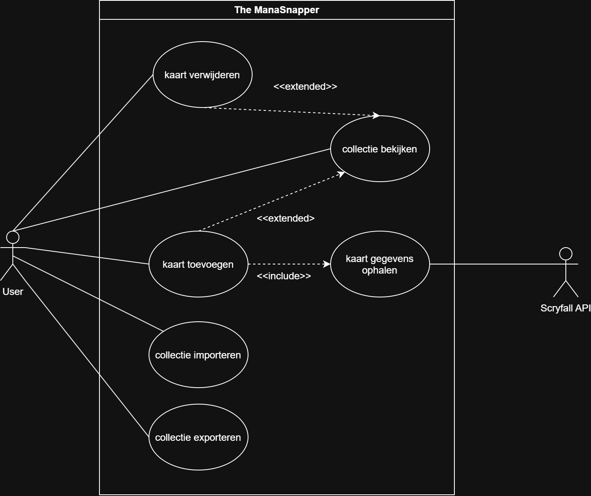

# Use Case Document voor The ManaSnapper

## Use Case Diagram.

## Use Case Beschrijvingen

| UC01 | Collectie Bekijken |
|---|---|
| Beschrijving | De opgeslagen kaarten in de collectie kunnen bekijken. |
| Pre-condities | De user kan de kaarten in hun collectie bekijken. |
| Post-condities | De kaarten uit de collectie zijn weergegeven. |
| Scenario | 1. De collectie wordt geopened.   2. De opgeslagen kaarten worden opgehaald.   3. De kaarten worden weergegeven.   4. Er wordt gewacht totdat de gebruiker een kaart klikt.   5. Bij het selecteren van een kaart wordt de kaart in meer detail getoond. |
| Uitzonderingen | - Als de collectie geen kaarten bevat, wordt een melding weergegeven dat de collectie leeg is.   - Als de collectie niet kan worden ingelezen, wordt een foutmelding weergegeven. |

| UC02 | Kaart Toevoegen |
|---|---|
| Beschrijving | Een kaart kan aan de collectie toegevoegd worden. |
| Pre-condities | de collectie kan worden aangepast. |
| Post-condities | de gescande of gekozen kaart is toegevoegd. |
| Scenario | 1. Er wordt gewacht totdat een kaart wordt opgegeven.   2. De kaart wordt geïdentificeerd.   3. De kaartgegevens worden opgehaald.   4. De opgehaalde kaartgegevens worden weergegeven.   5. Er wordt gewacht op bevestiging om de kaart toe te voegen.   6. De kaart wordt aan de collectie toegevoegd.   7. De bijgewerkte collectie wordt opgeslagen. |
| Uitzonderingen | - Als er geen kaart kan worden geïdentificeerd, wordt gemeld dat de kaart niet herkend is.   - Als de kaartgegevens niet kunnen worden opgehaald, wordt gemeld dat de kaart niet gevonden is.   - Als de gebruiker het toevoegen annuleert, wordt de kaart niet aan de collectie toegevoegd.|

| UC03 | Kaart Verwijderen |
|---|---|
| Beschrijving | een kaart uit de collectie verwijderen. |
| Pre-condities | de collectie word bekeken. |
| Post-condities | de gecelecteerde kaart is verwijdert van de collectie. |
| Scenario | 1. De kaarten uit de collectie worden weergegeven.   2. Er wordt gewacht totdat een kaart wordt geselecteerd.   3. De geselecteerde kaart wordt weergegeven.   4. Er wordt gevraagd om bevestiging voor het verwijderen.   5. Er wordt gewacht op bevestiging.   6. De geselecteerde kaart wordt uit de collectie verwijderd.   7. De bijgewerkte collectie wordt opgeslagen.   8. De bijgewerkte collectie wordt weergegeven. |
| Uitzonderingen | - Als de gebruiker het verwijderen annuleert, blijft de kaart in de collectie staan.   - Als de geselecteerde kaart niet meer in de collectie staat, wordt een foutmelding weergegeven en blijft de collectie ongewijzigd. |

| UC04 | Kaartgegevens Ophalen |
|---|---|
| Beschrijving | De gegevens van een kaart ophalen uit Scryfall. |
| Pre-condities | Een kaart is geïdentificeerd en de benodigde kaartinformatie is beschikbaar. |
| Post-condities | De gegevens van de kaart zijn ontvangen en beschikbaar om aan de collectie toe te voegen. |
| Scenario | 1. De kaartidentificatie wordt ontvangen.   2. De kaart wordt opgezocht bij Scryfall.   3. De kaartgegevens worden ontvangen.   4. De kaartgegevens worden beschikbaar gesteld aan de use case die de kaart heeft toegevoegd.|
| Uitzonderingen | - Als Scryfall geen kaart met de opgegeven gegevens vindt, wordt gemeld dat de kaart niet gevonden is.   - Als Scryfall niet bereikbaar is, wordt gemeld dat de kaartgegevens niet opgehaald kunnen worden.   - Als de ontvangen kaartgegevens ongeldig zijn, worden de gegevens niet toegevoegd aan de collectie. |

| UC05 | Collectie Importeren |
|---|---|
| Beschrijving | Een bestaande collectie vanaf de computer inladen. |
| Pre-condities | Er is een bestand met een collectie beschikbaar. |
| Post-condities | De kaarten uit het geïmporteerde bestand zijn opgeslagen in de collectie. |
| Scenario | 1. Er wordt gewacht totdat de gebruiker een collectiebestand selecteert.   2. Het geselecteerde bestand wordt ingelezen.   3. De inhoud van het bestand wordt gecontroleerd.   4. De kaarten uit het bestand worden toegevoegd aan de collectie.   5. De bijgewerkte collectie wordt opgeslagen.   6. Er wordt gemeld dat de collectie succesvol is geïmporteerd. |
| Uitzonderingen | - Als er geen bestand wordt geselecteerd, wordt de import geannuleerd.   - Als het bestand niet kan worden gelezen, wordt een foutmelding weergegeven en blijft de bestaande collectie ongewijzigd.   - Als het bestand geen geldig collectieformaat bevat, wordt een foutmelding weergegeven en wordt de collectie niet aangepast. |

| UC06 | Collectie Exporteren |
|---|---|
| Beschrijving | De opgeslagen collectie opslaan op de computer. |
| Pre-condities | Er is een collectie beschikbaar om te exporteren. |
| Post-condities | De collectie is opgeslagen in een bestand op de computer. |
| Scenario | 1. De collectie wordt opgehaald.   2. Er wordt gewacht totdat de gebruiker een locatie en bestandsnaam opgeeft.   3. De collectie wordt omgezet naar het gekozen bestandsformaat.   4. Het bestand wordt opgeslagen op de computer.   5. Er wordt gemeld dat de collectie succesvol is geëxporteerd. |
| Uitzonderingen | - Als de gebruiker geen locatie selecteert, wordt de export geannuleerd.   - Als het bestand niet kan worden opgeslagen, wordt een foutmelding weergegeven.   - Als de collectie leeg is, wordt gemeld dat er geen kaarten zijn om te exporteren. |
